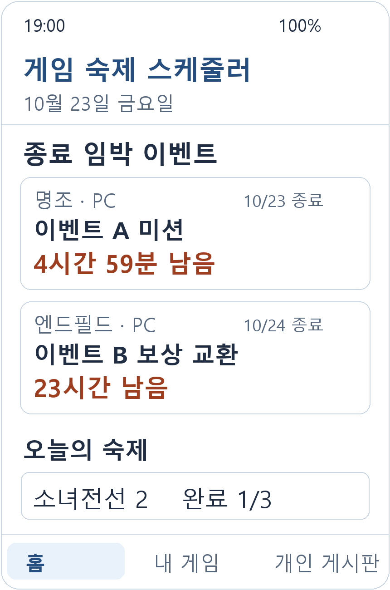
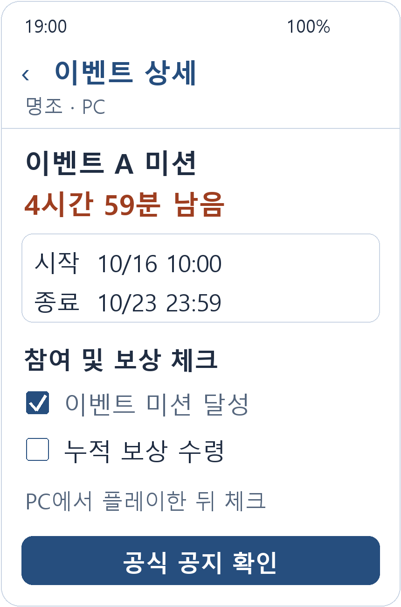
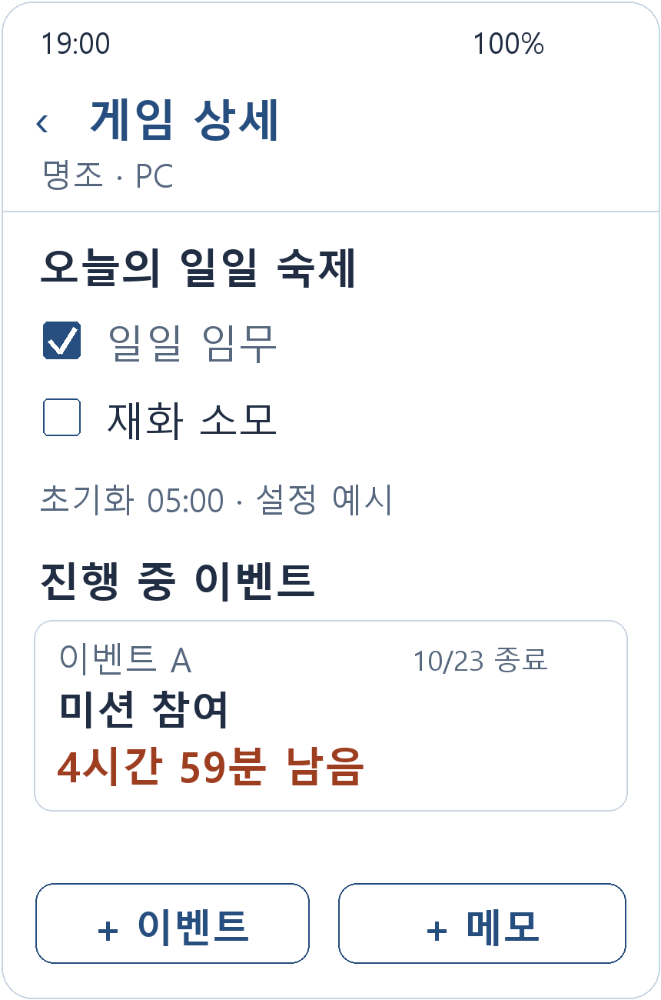
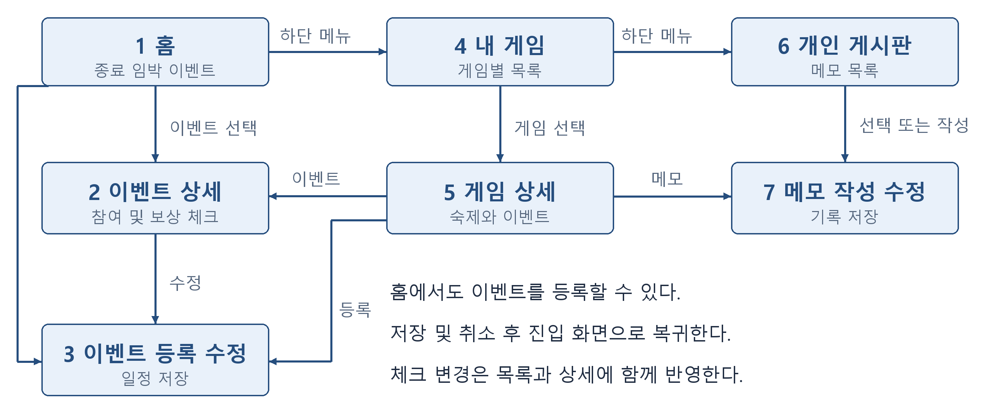
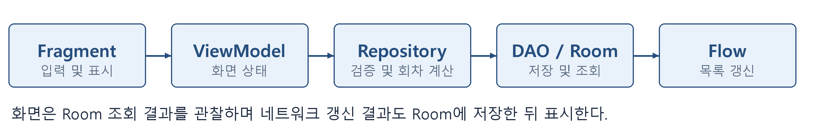

# 게임 숙제 스케줄러

여러 게임의 이벤트 마감일과 일일 숙제를 한곳에 모아, 종료가 가까운 미완료 이벤트부터 확인하는 개인용 Android 앱입니다.

| 항목 | 내용 |
| --- | --- |
| 작성자 | 김태준 |
| 학번 | 2026626007 |
| 과목 | AI 활용 모바일 |
| 개발 형태 | 1인 프로젝트 |
| 대상 플랫폼 | Android |
| 저장소 | [pktewon/game-homework-scheduler](https://github.com/pktewon/game-homework-scheduler) |
| 공개 범위 | 공개 — 로그인 없이 기획·설계 자료 열람 가능 |
| 현재 단계 | 기획·설계 및 엔필 공지 수집기 구현, Android 앱 구현 예정 |
| 관리 대상 예시 | 명조, 명일방주 엔드필드, 소녀전선 2 |

## 기획 의도와 문제인식

저는 여러 게임을 즐기고 노트북으로도 플레이합니다. 각 게임에는 일일 숙제 외에도 여러 이벤트가 진행되며, 이벤트마다 참여 기간과 보상 교환 기간이 다릅니다. 매일 일일 퀘스트만 처리하다 보면 별도로 진행되는 이벤트의 종료일을 잊어버려 참여나 보상 수령 기회를 놓칠 수 있습니다.

이 앱은 플레이 전에 여러 게임의 마감 일정을 확인하고, 플레이 후에 남은 참여 항목과 보상 수령 여부를 기록하기 위해 기획했습니다.

## 문제정의와 해결 방향

**여러 게임을 병행하는 사용자가 흩어진 이벤트의 종료 시각과 자신의 참여 상태를 함께 파악하기 어렵다**는 문제를 해결하고자 합니다.

홈 상단에 진행 중인 미완료 이벤트를 종료 시각순으로 배치합니다. 일일 숙제 요약은 그 아래에 표시합니다. 임무 참여와 보상 교환의 마감이 다르면 각각의 일정으로 관리하고, 관련 일정끼리는 묶어서 볼 수 있도록 설계했습니다.

예를 들어 오늘 일일 숙제를 모두 마쳤더라도 이벤트 보상을 아직 수령하지 않았다면, 해당 이벤트는 홈의 미완료 목록에 남습니다.

## 제출 문서

- [중간고사 기획·설계서 PDF](docs/planning/Midterm_2026626007_김태준.pdf)
- [중간고사 기획·설계서 Word](docs/planning/Midterm_2026626007_김태준.docx)
- [7개 화면과 화면 이동 설계](docs/screen-design.md)
- [Room 데이터베이스 설계](docs/database-design.md)
- [데이터 처리와 자동 업데이트 설계](docs/event-sync-plan.md)
- [세 게임의 일정 입력과 인게임 완료 연동 검토](docs/integration-decision.md)
- [공식 공지 수집·세부 일정·숙제 등록 상세 설계](docs/notice-ingestion-design.md)
- [JSON 형식 예시 — 실제 일정 아님](docs/examples/catalog.example.json)
- [엔필 수집기 실행 방법과 실제 수집 범위](docs/endfield-collector.md)
- [공식 공지에서 생성한 엔필 일정 JSON — 검수 후보](data/endfield-asia.candidate.json)
- [기말 개발 일정과 점검표](docs/development-plan.md)

기획서 첫 페이지에 실제 저장소 주소를 반영했으며, 교수자가 로그인 없이 확인할 수 있도록 저장소를 공개했습니다.

## 엔필 수집기 실행

Python 3.10 이상에서 추가 패키지 설치 없이 실행합니다.

```console
python -m collector.endfield
python -m unittest discover -s tests -v
```

2026-10-23에 공식 「단청도」 공지를 직접 수집해 이벤트 묶음 11개, 세부 일정 15개, 일일 확인 숙제 4개를 생성했습니다. 양쪽 기간이 명시된 일정 7개와 확인이 필요한 일정 8개를 구분했습니다. 테스트 17개가 통과했습니다.

현재는 공지 URL 한 건의 ‘신규 이벤트’ 구간을 읽는 CLI입니다. 생성 JSON은 `CANDIDATE`, `autoImportAllowed=false`이며 실제 앱 배포 전 검수가 필요합니다. 원문 전체를 저장소에 복제하지 않고 출처·기간·추출 근거와 확인용 템플릿을 저장합니다. [실행 안내](docs/endfield-collector.md)에서 범위와 제한을 확인할 수 있습니다.

## 핵심 기능

| 기능 | 계획한 동작 |
| --- | --- |
| 게임 등록과 바로가기 | 게임·서버·주 이용 기기를 등록합니다. 휴대폰에 설치된 모바일 게임은 실행 버튼으로 연결합니다. |
| 이벤트 가져오기와 수정 | 검수된 카탈로그에서 일정·참여 항목·기간 한정 숙제를 함께 등록하고 필요하면 직접 수정합니다. |
| 종료 임박 이벤트 조회 | 진행 중인 미완료 이벤트를 종료 시각순으로 표시하고 24시간 이내 마감을 강조합니다. |
| 참여 및 보상 체크 | 미션 달성과 보상 수령을 별도 항목으로 체크해 남은 작업을 확인합니다. |
| 일일 숙제와 완료 기록 | 게임별 초기화 시각에 맞춰 현재 회차의 숙제를 표시하고 이전 완료 기록을 보존합니다. |
| 개인 게시판과 메모 | 게임별 주의사항과 메모를 저장하며 필요한 경우 특정 이벤트에 연결합니다. |

게임 실행은 플레이 진입을 돕는 기능입니다. 숙제 완료 여부는 사용자가 직접 체크합니다. PC 게임은 노트북에서 플레이한 뒤 Android 앱에 완료를 기록합니다. 개인 게시판은 본인만 사용하는 메모 공간입니다.

## 화면 설계

아래 이미지는 구현 전 화면 시안입니다. 이벤트명·날짜·체크 상태는 설명용 예시입니다.

| 홈 | 이벤트 상세 | 게임 상세 |
| --- | --- | --- |
|  |  |  |

화면은 홈, 이벤트 상세, 이벤트 등록·수정, 내 게임, 게임 상세, 개인 게시판, 메모 작성·수정의 7개 Fragment로 구성할 예정입니다. [전체 화면 시안과 UI 역할](docs/screen-design.md)을 별도 문서에 정리했습니다.

### 화면 이동



이벤트와 메모 저장 후에는 진입 화면으로 돌아가 목록을 갱신합니다. 취소한 입력은 저장하지 않습니다.

## Room 데이터베이스 설계


| 테이블 | 저장할 데이터 |
| --- | --- |
| `games` | 게임 이름, 이용 서버, 서버 시간대, 초기화 시각, 플레이 기기 |
| `events` | 이벤트 기간, 관련 일정 묶음, 공지 출처, 갱신 및 검토 상태 |
| `event_check_items` | 이벤트별 참여 항목과 보상 수령 여부 |
| `daily_tasks` | 게임별 반복 숙제의 정의 |
| `daily_task_records` | 숙제별·회차별 완료 기록 |
| `memos` | 게임 또는 이벤트에 연결된 개인 메모 |
| `event_sources` | 자동 갱신 경로와 성공·실패 기록을 위한 확장 테이블 |

기본 구현은 6개 테이블입니다. 숙제 정의와 완료 기록을 분리해 초기화 후에도 과거 기록이 사라지지 않게 설계했습니다. 시각은 UTC 밀리초로 저장하고 표시할 때 한국 시간으로 변환합니다. 회차 계산에는 게임 서버의 시간대와 초기화 시각을 적용합니다.

각 컬럼의 자료형·PK·FK와 기록 보존 규칙은 [DB 설계 문서](docs/database-design.md)에 정리했습니다.

## 개발 기술과 데이터 처리 계획

| 항목 | 적용 계획 |
| --- | --- |
| 언어와 도구 | Kotlin, Android Studio, Git, GitHub |
| 화면과 이동 | XML Layout, Fragment, Navigation Component |
| 목록 표시 | RecyclerView |
| 로컬 데이터 | Room, Entity, DAO, AppDatabase |
| 상태 및 비동기 처리 | ViewModel, Repository, Coroutines, Flow |
| 외부 앱 연결 | 설치된 모바일 게임 실행용 Intent |
| 확장 기능 | JSON 일정 수신과 WorkManager 기반 배경 갱신 |



사용자 입력은 Fragment → ViewModel → Repository → DAO → Room 순서로 전달합니다. 조회 결과를 관찰해 목록과 체크 상태를 갱신하고, 시간 경과나 앱 복귀 시 종료 상태와 숙제 회차를 다시 계산합니다. 연관된 저장은 트랜잭션으로 처리할 예정입니다.

### 이벤트 자동 업데이트 범위

일정은 자동으로 가져오고 완료는 직접 체크하는 방식으로 확정했습니다. 명조·엔필 Asia, 소전2 HAOPLAY 한국판의 프로필을 구분합니다. 검수된 일정 JSON 수신·Room 병합을 앱의 목표 기능으로 두고, 수집기는 엔필·명조·소전2 순으로 검증합니다. 소전2는 공개 카페 본문 확보가 불확실하면 검수 입력을 병행하며 앱은 같은 카탈로그를 자동으로 받습니다.

엔드필드는 공식 한국어 공지를 직접 읽는 첫 수집기를 구현했습니다. 공지 목록 자동 탐색, 검수·운영 피드 배포, 세 게임의 실시간 자동 수집은 아직 구현하지 않았습니다. 종료 시각이 불명확하면 `기간 확인 필요`로 남기고, 실패 시 이전 JSON을 유지합니다.

**일정 자동 가져오기와 개인 완료 자동 반영은 별개입니다.** 기말 버전은 공식 공지로 검수한 일정을 등록하고, 참여·보상 수령은 사용자가 체크합니다. 엔드필드는 공식 SKPORT에 일일·주간 진행 정보가 있지만, 우리 앱에서 쓸 수 있는 외부 연동 경로와 개별 이벤트 완료 필드는 따로 확인해야 합니다. 명조의 중국권 계정 도구나 소녀전선 2 글로벌 공지를 한국 이용 서버에 그대로 적용하지 않습니다. 세 게임의 차이와 입력 수고를 줄이는 방법은 [연동 검토 문서](docs/integration-decision.md)에 정리했습니다.

자세한 단계와 실패·중복·변경 처리 기준은 [자동 업데이트 설계](docs/event-sync-plan.md)를 참고해 주세요.
공식 출처별 수집 방식, 참여·단계 개방·교환·일일 숙제 분해 규칙과 DB 보완안은 [공지 수집 상세 설계](docs/notice-ingestion-design.md)에 정리했습니다. 예제 JSON은 가상 자료이며 운영 일정으로 사용할 수 없습니다.

## 기말까지의 개발 일정

| 기간 | 개발 내용 | 완료 기준 |
| --- | --- | --- |
| 9~10주차 | Android 프로젝트, Fragment·Navigation, GitHub 준비 | 예시 데이터로 7개 화면 이동과 뒤로가기 확인 |
| 11~12주차 | Room, 게임·이벤트 저장, 체크 항목, RecyclerView | 종료 시각순 표시와 앱 재실행 후 데이터 유지 |
| 13~14주차 | 숙제·메모, JSON 수신·병합, 모바일 바로가기 | 초기화 전후 기록과 갱신 시 개인 체크 보존 확인 |
| 15~16주차 | 실제 기기 점검, 오류 수정, 문서 보완, 시연 | 주요 기능 시연과 최종 코드·APK 준비 |

앱의 카탈로그 자동 수신을 목표로 하며 세 게임 수집기 전체의 무인 운영은 별도 검증 범위입니다. 사용자 간 커뮤니티, 계정 동기화, PC 원격 실행과 인게임 완료 자동 판정은 이번 필수 구현 범위에 포함하지 않습니다.

## 현재 진행 상태

- [x] 본인 경험을 바탕으로 문제인식과 문제정의 정리
- [x] 핵심 기능 6개와 화면 시안 7개 작성
- [x] 화면 이동 및 DB·데이터 처리 흐름 설계
- [x] 1인 개발 일정과 AI 활용 내용 작성
- [x] 이름·학번을 반영한 기획서와 GitHub 업로드용 파일 준비
- [x] 실제 GitHub 저장소 생성·문서 업로드 및 기획서 주소 반영
- [x] 이름·학번 공개 승인에 따라 저장소 공개 전환
- [x] 세 게임의 이용 서버 확정 및 공지 수집·자동 등록 상세 설계
- [x] 엔필 공식 공지 실제 수집, JSON 생성 및 테스트 17개 통과
- [ ] 수업 제출 시스템에 최종 PDF와 저장소 주소 제출
- [ ] Android 앱 코드 구현과 실제 기기 검증
- [ ] 최종 APK와 시연 자료 준비

## 현재 확인 방법

기획·설계 문서와 화면 시안, Python 엔필 수집기 및 실제 수집 JSON이 들어 있습니다. 문서는 README와 제출 PDF로, 수집기는 위 실행 명령으로 확인할 수 있습니다. Android 소스 코드, Gradle 프로젝트와 APK는 아직 포함되어 있지 않습니다.

## 저장소 구성

```text
game-homework-scheduler/
├── README.md
├── .gitignore
├── .gitattributes
├── collector/                       # 엔필 공식 공지 수집기와 고정 키 등록부
├── tests/                           # 네트워크 없는 단위 테스트
├── data/endfield-asia.candidate.json # 실제 공지 추출, 검수 후보
└── docs/
    ├── planning/
    │   ├── Midterm_2026626007_김태준.pdf
    │   └── Midterm_2026626007_김태준.docx
    ├── screen-design.md
    ├── database-design.md
    ├── event-sync-plan.md
    ├── integration-decision.md
    ├── notice-ingestion-design.md
    ├── examples/catalog.example.json  # 가상 형식 예시
    ├── development-plan.md
    └── design/
        ├── screens/                 # 7개 화면 시안
        ├── navigation.png
        ├── database-relations.png
        ├── data-flow.png
        └── sync-flow.png
```

## AI 활용 내용

OpenAI Codex를 활용해 아이디어 구체화, 문제인식·문제정의, 화면·Room 설계, 공식 문서 조사, 일정·문서 작성, 엔필 수집기와 테스트 작성을 보조받았습니다. 수집기를 실제 공식 공지에 실행하고 날짜·서버 처리 및 실패 시 보존 동작을 검증했습니다. 사용 경험과 핵심 문제는 작성자가 제시했습니다. Android 개발에서도 코드를 이해하고 실제 실행·검증한 뒤 반영할 예정입니다.

## 참고 자료

- [명조 공식 3.3 버전 내용 안내](https://wutheringwaves.kurogames.com/kr/main/news/detail/4615) — 참여와 교환 기간이 다른 일정 구조 검토
- [엔드필드 공식 버전 업데이트 설명](https://endfield.gryphline.com/ko-kr/news/9560) — 서버 시간대와 기간 표현 검토
- [소녀전선 2 개발사 앱 소개](https://apps.apple.com/kr/app/id6499011827) — 공식 공지 채널 확인
- [Android Developers Room 일대다 관계](https://developer.android.com/training/data-storage/room/relationships/one-to-many)
- [Android Developers WorkManager 작업 정의](https://developer.android.com/develop/background-work/background-tasks/persistent/getting-started/define-work)

게임 공지는 설계 사례로 참고했습니다. 화면 시안에 표시한 날짜는 실제 진행 이벤트 안내가 아닙니다.
