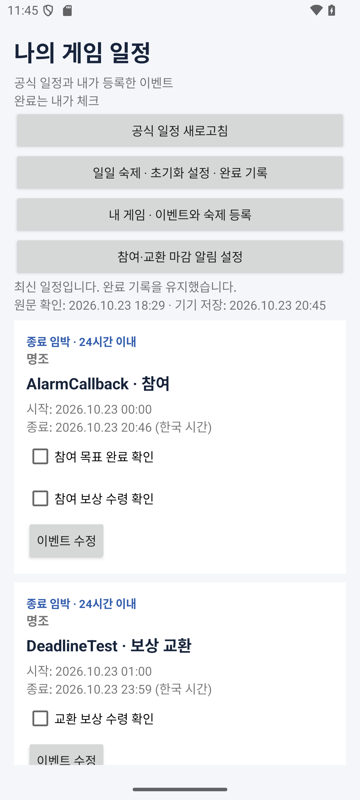

# Android 구현: 일정 수신·Room 저장·회차별 완료 기록

2026-10-23 기준 엔필 Asia 수신과 일일 숙제 체크, 게임/개인 숙제 등록·수정을 구현했다. 앱 0.3.0의 현재 동작을 정리하며, 중간고사 시안의 7개 화면 전체를 완성한 단계는 아니다.

## Android Studio에서 열기

Android Studio는 이 저장소의 코드를 편집·동기화·빌드하고 에뮬레이터나 휴대폰에 실행하는 도구다. 코드 작성 장소와 무관하게 같은 Gradle 프로젝트를 사용한다.

1. 저장소를 복제하거나 프로젝트 ZIP을 푼다.
2. Android Studio의 **Open**에서 **`android` 폴더**를 선택한다. `settings.gradle.kts`가 있는 폴더다. 상위 README 폴더를 Android 프로젝트로 선택하지 않는다.
3. SDK 경로와 Gradle JDK를 확인하고 Gradle Sync가 끝날 때까지 기다린다. `local.properties`는 개인 SDK 경로이므로 Git에 올리지 않는다.
4. Android SDK Platform 35와 Build Tools 36.0.0을 준비한다. JDK 17로 검증했으며, Gradle 8.11.1·AGP 8.9.2·Kotlin 2.1.20·KSP 2.1.20-1.0.32·Room 2.7.2를 고정했다. 최소 기기는 Android 8.0(API 26)이다. 최신 버전으로 자동 변경할 필요는 없다.
5. 실행 구성 `app`과 에뮬레이터 또는 USB 디버깅 기기를 선택하고 **Run ▶** 한다. 첫 실행은 인터넷 연결이 필요하다. 첫 동기화 뒤에는 네트워크가 없어도 저장된 일정을 표시한다.

앱 설치 이름은 **게임 숙제 스케줄러**, 패키지는 `kr.ac.jeiu.gamescheduler`다. 휴대폰 앱 데이터를 삭제하거나 앱을 제거하면 이 기기의 개인 기록도 삭제된다. 서버 계정 동기화는 구현하지 않았다.

## 실행 화면과 사용법



위 이미지는 API 35 에뮬레이터에서 실제 공개 JSON을 받은 화면이다. 화면 시안과 별개다.

- 화면 진입 시 일정을 갱신하고 **공식 일정 새로고침**으로 다시 확인할 수 있다.
- 진행 중인 미완료 이벤트를 종료 시각순으로 먼저 보여준다. 확인 필요, 예정, 체크 완료, 종료, 콘텐츠 알림과 이전 항목도 구분한다.
- 기간 미확정 항목은 NULL을 유지하고 **확인 필요**로 표시한다. 자동 활성화·마감 알림에 사용하지 않는다. 이 초기 앱에는 알림 예약 기능 자체가 없다.
- 참여 목표와 보상 수령을 각각 직접 체크한다. 체크를 해제해도 다른 항목과 과거 일일 숙제 기록은 바뀌지 않는다.
- 원문 확인 시각과 기기 저장 시각을 표시하고 **공식 공지 보기**로 근거를 확인한다.
- **일일 숙제 · 초기화 설정 · 완료 기록**에서 서버 초기화 시각을 직접 지정하고 회차별 체크와 이력을 확인한다. 새 회차는 기록 삭제 없이 미완료로 표시된다. [일일 숙제 안내](daily-tasks.md)를 참고한다.
- **내 게임 · 게임과 숙제 등록**에서 명조·소전2 등을 추가한다. 게임별 일일 숙제 화면에서 개인 숙제를 등록·수정하고 완료를 기록한다. [개인 등록과 보존 규칙](manual-registration.md)을 참고한다.

## 수신과 저장 흐름

`HomeFragment → HomeViewModel → CatalogRepository → CatalogClient → 매니페스트/버전별 JSON 검증 → Room 트랜잭션 → Flow → RecyclerView`

수신은 HTTPS로 고정된 저장소의 매니페스트와 버전별 JSON만 읽는다. 리디렉션을 따라가지 않고 요청 제한 시간과 파일 크기 제한을 둔다. 바이트 수·SHA-256·배포 번호·프로필·검수 상태·기간·중복 키·지원 종류·집계 수를 검사한다. 개인 완료 필드가 들어온 공개 피드는 거부한다.

실패한 다운로드나 검증으로 Room 내용을 덮어쓰지 않는다. 이전 배포판과 같은 배포 번호의 다른 해시는 거부한다. 트랜잭션 도중 개정 번호가 잘못된 일정이 발견되면 앞서 처리한 변경도 함께 취소된다.

## 실제 Room 구조와 보존 규칙

DB 이름은 `game_scheduler_database`, 현재 스키마 버전은 3이다. [실제 Entity·DAO](../android/app/src/main/java/kr/ac/jeiu/gamescheduler/data/SchedulerDatabase.kt)와 [내보낸 스키마](../android/app/schemas/kr.ac.jeiu.gamescheduler.data.SchedulerDatabase/3.json)가 기준이다. 완료 기록을 별도로 분리했으며 개인 숙제는 공식 템플릿과도 분리했다. 메모 기능은 후속 구현이다.

| 테이블 | 식별자와 저장 내용 | 공지 갱신 시 |
| --- | --- | --- |
| `games` | 프로필 PK, 이름·서버 오프셋·미확정 초기화 분(NULL) | 최초 생성만, 사용자 설정 보존 |
| `events` | `sourceKey` PK, 제목·기간·종류·근거·예외 노트 | 같은 키의 메타데이터 갱신 |
| `check_templates` | `(eventKey, sourceItemKey)` PK, 체크 제목·순서 | 템플릿만 갱신 |
| `check_records` | 동일 복합 PK, `isDone`·`completedAt` | **가져오기에서 쓰지 않음** |
| `daily_tasks` | `(eventKey, sourceTaskKey)` PK, 숙제 템플릿 | 정의만 갱신 |
| `daily_task_records` | 위 키와 `cycleStartAt` 복합 PK, 완료 시각·설정 분·기간 직접 확인 여부 | **가져오기에서 쓰지 않음**, 사용자 체크로 저장 |
| `sync_state` | 프로필 PK, 적용한 배포 개정·해시·시각 | 트랜잭션 성공 후 갱신 |
| `personal_daily_tasks` | 개인 숙제 UUID PK, 게임 FK·제목·설명·사용 여부 | 공지 수신은 접근하지 않음 |
| `personal_daily_records` | `(taskId, cycleStartAt)` PK, 완료 시각·당시 시간 설정 | 공지 수신은 접근하지 않음 |

`@Upsert`로 메타데이터를 갱신한다. 부모 행을 삭제하고 다시 삽입하는 `REPLACE`는 쓰지 않는다. 모든 FK 삭제 정책은 `RESTRICT`다. 공지에서 사라진 일정·체크·숙제는 `missingFromLatest=true`로 보관하고, 같은 키가 돌아오면 표시 상태만 복원한다. 따라서 이름·기간·체크 제목이 바뀌어도 기존 완료 여부와 완료 시각이 보존된다. `CheckRow` DB View가 템플릿과 개인 기록을 LEFT JOIN하고 Room Flow가 화면을 갱신한다.

1→2는 일일 완료의 근거 컬럼을 추가하고, 2→3은 게임 메타데이터 컬럼과 개인 숙제/기록 테이블을 추가한다. 기존 데이터는 보존한다. 내보낸 v1/v2 스키마로 만든 DB의 업그레이드를 검증했으며 파괴적 재생성은 사용하지 않는다.

## 검증 방법과 결과

`android` 폴더에서 실행한다.

```powershell
.\gradlew.bat :app:assembleDebug :app:testDebugUnitTest :app:lintDebug
```

macOS/Linux는 `./gradlew`를 사용한다. 디버그 APK는 `app/build/outputs/apk/debug/app-debug.apk`에 생성된다. 빌드 폴더와 로컬 서명 키는 Git에서 제외한다.

2026-10-23 검증 결과:

- 디버그 APK 빌드 성공. Lint 오류 0건. 최신 의존성 권고·문자열 리소스화·앱 아이콘 등 초기 UI 경고는 남아 있다.
- Robolectric의 실제 Room SQLite로 **34개 테스트 통과**. 수신·병합 12개, 회차·설정 14개, 개인 등록·수정·격리·업그레이드 8개다. 배포 JSON 실제 파일을 입력으로 사용한다.
- 제목·종료일·체크 문구 변경, 확인 필요→기간 확정, 중복 수신, 사라짐→재등장, 체크 항목 제거 후에도 완료 기록 보존을 확인했다.
- 오프라인·해시 오류·다른 서버·후보 피드·중복 키·알 수 없는 종류·개인 상태 포함·이전 개정 거부 및 트랜잭션 전체 취소를 검증했다.
- 파일 DB를 닫고 다시 열었을 때의 이벤트 체크와, 공지 갱신 후 일일 완료 기록 보존을 확인했다.
- 읽기 전용 API 35 에뮬레이터에서 공개 GitHub 피드의 **15개 일정 수신**, **기간 확인 필요 표시**, **체크 후 새로고침**, **강제 종료 후 재실행 시 체크 유지**를 확인했다. 실제 배포 서버의 일정을 바꾼 테스트는 하지 않았으며, 메타데이터 변경 시 보존은 로컬 피드와 Room 테스트로 검증했다.

일일 회차는 [회차 규칙](daily-tasks.md), 다중 게임·개인 숙제는 [등록·수정 안내](manual-registration.md)에 정리했다. 남은 범위는 공식 기간 수동 편집·메모·배경 갱신·알림·명조/소전2 공식 수집기다. 게임/숙제 수동 등록은 여러 게임을 지원하고 공식 수신은 엔필 Asia를 지원한다.

참고: [Room 비동기 쿼리](https://developer.android.com/training/data-storage/room/async-queries), [Room 버전·컴파일러 설정](https://developer.android.com/jetpack/androidx/releases/room), [AGP 8.9 호환성](https://developer.android.com/build/releases/agp-8-9-0-release-notes).

[README](../README.md) · [배포 계약과 검수 결과](endfield-release.md)
