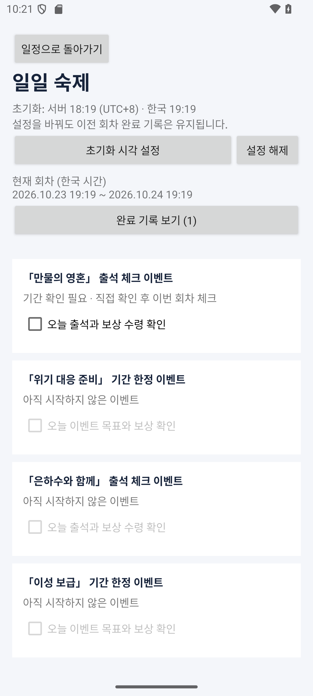
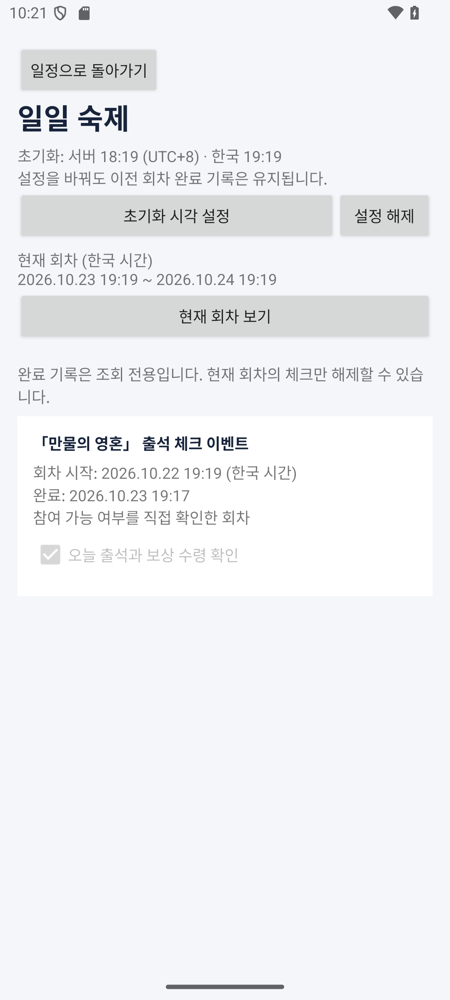

# 일일 숙제: 초기화 설정·회차 체크·완료 기록

Android 앱 0.2.0에서 엔필 Asia의 일일 숙제를 직접 체크할 수 있다. 공지에서 가져온 숙제는 확인용 템플릿이며 인게임 자동 완료 정보가 아니다.

0.3.0부터 게임별 개인 숙제도 등록·수정·체크할 수 있다. 이 문서는 공식 숙제의 회차 규칙을 설명하며, 다중 게임과 개인 숙제의 별도 테이블·시간 기준 설정은 [직접 등록 안내](manual-registration.md)를 참고한다. 현재 DB는 버전 3이며 아래 1→2 경로에 이어 2→3 마이그레이션을 사용한다.

## 사용 방법

1. 홈에서 **일일 숙제 · 초기화 설정 · 완료 기록**을 누른다.
2. **초기화 시각 설정**에서 게임에서 확인한 **Asia 서버 시각(UTC+8)**을 입력한다. 앱이 실제 시각을 추정해 기본 저장하지 않는다. 설정 옆에 한국 시각도 함께 표시한다.
3. 현재 회차의 숙제를 마쳤으면 체크한다. 기간이 확정된 진행 중 이벤트는 바로 저장한다. 공식 기간이 불명확하면 게임에서 지금 참여 가능한지 직접 확인한 뒤 **확인했고 완료했어요**를 누른다. 이 경우도 공식 일정의 NULL과 ‘확인 필요’는 바꾸지 않는다.
4. **완료 기록 보기**에서 이전 회차를 포함한 전체 완료 기록을 본다. 기록 목록은 조회 전용이다. 체크 해제는 현재 회차에서만 할 수 있다.

초기화 시각이 미설정이거나 아직 시작하지 않았거나 이미 끝난 이벤트는 새 완료를 체크할 수 없다. 참여 가능 직접 확인으로 공지에 명시된 시작·종료 시각을 무시할 수 없다. 이전 공지 항목도 새 완료는 막고 기록은 보관한다.

| 현재 회차 | 이전 완료 기록 |
| --- | --- |
|  |  |

이미지의 초기화 시각은 에뮬레이터 경계 테스트를 위해 임시로 지정한 값이다. 게임의 실제 초기화 시각을 안내하는 값이 아니다.

## 회차를 나누는 규칙

회차는 서버 시간대의 설정한 초기화 시각부터 다음 날 같은 시각 직전까지다. 날짜가 자정에 바뀌었다는 이유로 초기화하지 않는다. 시각은 UTC 밀리초로 저장하고 화면에는 한국 시각으로 표시한다.

예를 들어 사용자가 서버 04:00을 설정했다면 한국에서는 05:00에 새 회차가 시작된다. 한국 04:59:59는 이전 회차이고 05:00:00부터 새 회차다. **이 예시는 계산 설명이며 공식 초기화 시각 확인을 대신하지 않는다.**

현재 회차는 화면이 열려 있는 동안 매초 다시 계산하고 앱 복귀 시 즉시 갱신한다. 기록을 지우는 자정 작업이나 배경 초기화 작업은 없다. 새 회차의 키로 저장된 완료가 없으면 미완료로 보인다. 앱을 꺼두었더라도 다음에 열 때 올바른 회차를 계산한다.

초기화 설정을 바꾸거나 해제해도 과거 기록의 회차 키를 이동·삭제하지 않는다. 설정 변경으로 현재 회차가 달라지면 현재 체크도 다르게 보일 수 있지만 이전 기록 보기에는 그대로 남는다. 같은 설정과 같은 회차로 돌아오면 그 회차의 기록을 다시 연결한다.

## 저장과 안전한 수정

- 완료 기록 PK는 `(eventKey, sourceTaskKey, cycleStartAt)`다. 같은 회차를 두 번 눌러도 중복을 만들거나 최초 완료 시각을 바꾸지 않는다.
- 완료 체크 시 실제 사용자 동작으로만 행을 INSERT한다. 미완료 행을 일괄 생성하거나 이전 행을 자동 삭제하지 않는다.
- 해제는 현재 회차의 정확한 복합 키 한 건만 DELETE한다. 이벤트 참여·보상 체크와 다른 회차 기록은 건드리지 않는다.
- 체크 요청에는 화면이 보고 있던 회차와 설정값을 함께 보낸다. 저장 직전 트랜잭션에서 실제 현재 회차를 다시 계산한다. 경계나 설정이 달라졌으면 저장을 거부하고 새 회차에서 다시 체크하도록 안내한다. 오래 열린 확인 대화상자에도 같은 검증을 적용한다.
- 미확정 기간 직접 확인은 그 완료 기록에 `periodConfirmedByUser=true`로 남긴다. 다음 회차의 참여 가능을 자동 승인하지 않는다.
- 기록에는 `resetMinuteAtCompletion`도 남긴다. 완료 당시 초기화 설정을 추적할 수 있으며, 기록 목록은 저장된 원래 `cycleStartAt`을 사용한다.
- 공지 수신은 개인 완료 테이블과 초기화 설정을 갱신하지 않는다. 기존 개인 기록과 연결된 숙제·이벤트가 공지에서 빠져도 행을 보관하므로 이력 조회가 유지된다.

관련 코드: [회차 계산·저장](../android/app/src/main/java/kr/ac/jeiu/gamescheduler/data/DailyRepository.kt), [화면·설정](../android/app/src/main/java/kr/ac/jeiu/gamescheduler/DailyFragment.kt), [현재 회차·기록 행](../android/app/src/main/java/kr/ac/jeiu/gamescheduler/DailyAdapter.kt).

## 기존 설치 데이터 업그레이드

Room DB는 **버전 1 → 2**로 올렸다. [마이그레이션](../android/app/src/main/java/kr/ac/jeiu/gamescheduler/data/SchedulerDatabase.kt)은 기존 일일 기록 테이블에 완료 당시 초기화 분(NULL 허용)과 직접 확인 여부(기본 false) 두 컬럼만 추가한다. 기존 게임 설정·일정·참여 체크·일일 완료·동기화 상태는 유지한다. 파괴적 DB 재생성은 사용하지 않는다.

[버전 1 스키마](../android/app/schemas/kr.ac.jeiu.gamescheduler.data.SchedulerDatabase/1.json)와 [버전 2 스키마](../android/app/schemas/kr.ac.jeiu.gamescheduler.data.SchedulerDatabase/2.json)를 함께 보관한다. 이전 APK를 삭제하지 않고 새 APK를 덮어 설치해야 기존 데이터가 유지된다. 앱 제거·데이터 삭제에 대한 복원이나 서버 백업은 구현하지 않았다.

## 검증

```powershell
cd android
.\gradlew.bat :app:assembleDebug :app:testDebugUnitTest :app:lintDebug
```

수신·Room 테스트 12개와 일일 숙제 테스트 14개, 개인 등록·수정 테스트 8개로 현재 총 **34개**가 통과했다. 회차 기능에서는 다음을 확인했다.

- 초기화 직전·정각, 자정·월말·연말, 00:00·23:59 설정과 서버/한국 시각 변환
- 새 회차 미완료 표시, 이전 완료 보존, 현재 회차만 해제, 중복 체크 시 최초 시각 보존
- 시각 변경·해제·재설정, 늦게 도착한 체크·해제 거부, DB 재실행 후 설정·기록 유지
- 미확정 기간의 회차별 직접 확인, 미래·종료·이전 항목 체크 금지
- 공지 갱신 후 초기화 설정과 완료 기록 보존
- 내보낸 실제 버전 1 스키마로 DB를 만들고 2로 열었을 때 설정·참여 체크·과거 일일 기록 보존 및 새 회차 저장

API 35 읽기 전용 에뮬레이터에서도 이전 APK의 체크를 새 APK로 업그레이드해 유지하고, 초기화 시각 설정 후 **실제 시간이 경계를 지날 때** 새 회차 미완료·이전 기록 유지, 현재 회차 해제, 공지 새로고침·프로세스 재실행 후 설정과 기록 유지를 확인했다. 테스트는 임시 초기화 값으로 실행했으며 공개 공지와 실제 게임 시각을 수정하지 않았다.

[Android Studio 실행 방법](android-implementation.md) · [README](../README.md)
