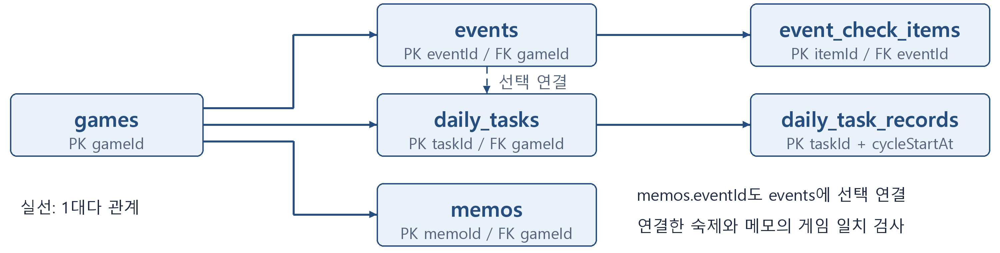

# Room 데이터베이스 설계

게임 숙제 스케줄러

DB 이름은 `game_scheduler_database`이다. 이 문서는 중간고사 시점의 6개 테이블 논리 설계다. 현재는 완료 기록과 개인 숙제를 분리하고 알림 설정·발송 이력·개인 메모를 포함한 12개 테이블을 사용한다. 실제 스키마·보존 규칙은 [Android 구현](android-implementation.md), [개인 등록·수정](manual-registration.md), [일일 회차](daily-tasks.md), [이벤트 직접 등록·수정](manual-events.md), [마감 알림](deadline-notifications.md), [개인 메모](personal-memos.md), [게임 실행 연결](game-shortcuts.md)이 기준이다.

## 공통 규칙

- PK는 기본키, FK는 외래키, NN은 NOT NULL, AUTO는 자동 증가이다.
- ID와 UTC 밀리초 시각은 SQLite `INTEGER`와 Kotlin `Long`으로 다룬다. 체크 값은 SQLite `INTEGER` 0·1로 저장한다.
- 서버 시간대는 IANA 식별자로 저장한다. `dailyResetMinute`는 서버 현지 자정부터 초기화까지의 분으로 0~1439 범위이다.
- 화면에는 한국 시간으로 변환한 일시를 표시하며, 회차 계산에는 해당 게임의 서버 시간대와 초기화 시각을 적용한다.
- FK 컬럼에 인덱스를 두고, 이벤트를 숙제나 메모에 연결할 때 같은 게임에 속하는지 검사한다.
- 이력이 있는 게임·이벤트는 숨김 처리하고, 과거 완료 기록이 있는 부모 행의 물리 삭제를 제한한다.

## 테이블 상세

### 테이블 1 games

| 컬럼 | SQLite 자료형 | 키와 제약 | 설명 |
| --- | --- | --- | --- |
| gameId | INTEGER | PK, AUTO | 게임 고유번호 |
| name | TEXT | NN | 게임 이름 |
| playPlatform | TEXT | NN | 주 이용 기기 PC / MOBILE |
| serverRegion | TEXT | NN | 이용 서버 및 지역 |
| serverTimeZone | TEXT | NN | 서버 시간대 |
| dailyResetMinute | INTEGER | NN, 0~1439 | 서버 현지 초기화 시각을 분으로 저장 |
| packageName | TEXT | NULL 허용 | 모바일 실행 대상 |
| isArchived | INTEGER | NN, 기본 0 | 게임 숨김 여부 |

저장 예시: gameId=1, name=명조, playPlatform=PC. 05:00 초기화는 300으로 저장한다.

### 테이블 2 events

| 컬럼 | SQLite 자료형 | 키와 제약 | 설명 |
| --- | --- | --- | --- |
| eventId | INTEGER | PK, AUTO | 일정 고유번호 |
| gameId | INTEGER | FK, NN | games.gameId |
| groupKey | TEXT | NULL 허용 | 관련된 세부 일정을 같은 묶음으로 표시 |
| title | TEXT | NN | 이벤트 또는 세부 일정 이름 |
| startAt | INTEGER | NULL 허용 | 시작 시각, 미확정이면 NULL |
| endAt | INTEGER | NULL 허용 | 종료 시각, 미확정이면 NULL |
| sourceKey | TEXT | NULL 허용 | 자동 수집 일정의 고정 식별값 |
| sourceUrl | TEXT | NULL 허용 | 공식 공지 주소 |
| syncPolicy | TEXT | NN | MANUAL / AUTO |
| reviewState | TEXT | NN | CONFIRMED / PENDING |
| pendingUpdateJson | TEXT | NULL 허용 | 확인할 변경안과 원문 근거 |
| isArchived | INTEGER | NN, 기본 0 | 일정 숨김 여부 |
| updatedAt | INTEGER | NN | 마지막 수정 시각 |

저장 예시: eventId=101, gameId=1, groupKey=event_A, title=이벤트 A 미션(예시). 보상 교환은 별도 일정이다.

### 테이블 3 event_check_items

| 컬럼 | SQLite 자료형 | 키와 제약 | 설명 |
| --- | --- | --- | --- |
| itemId | INTEGER | PK, AUTO | 세부 체크 항목 번호 |
| eventId | INTEGER | FK, NN | events.eventId |
| title | TEXT | NN | 미션 달성, 보상 수령 등 |
| isDone | INTEGER | NN, 기본 0 | 미완료 0 / 완료 1 |
| completedAt | INTEGER | NULL 허용 | 완료 시각, 체크 해제 시 NULL |
| sortOrder | INTEGER | NN | 화면 표시 순서 |

저장 예시: itemId=1001, eventId=101, title=누적 보상 수령, isDone=0.

### 테이블 4 daily_tasks

| 컬럼 | SQLite 자료형 | 키와 제약 | 설명 |
| --- | --- | --- | --- |
| taskId | INTEGER | PK, AUTO | 숙제 정의 고유번호 |
| gameId | INTEGER | FK, NN | games.gameId |
| eventId | INTEGER | FK, NULL 허용 | 이벤트 기간에만 반복하는 숙제 연결 |
| title | TEXT | NN | 일일 임무 등 숙제 이름 |
| isActive | INTEGER | NN, 기본 1 | 현재 사용 여부 |
| createdAt | INTEGER | NN | 등록 시각 |

저장 예시: taskId=201, gameId=1, eventId=NULL, title=일일 임무, isActive=1.

### 테이블 5 daily_task_records

| 컬럼 | SQLite 자료형 | 키와 제약 | 설명 |
| --- | --- | --- | --- |
| taskId | INTEGER | 복합 PK, FK | daily_tasks.taskId |
| cycleStartAt | INTEGER | 복합 PK | 해당 회차의 시작 시각 |
| completedAt | INTEGER | NN | 숙제 완료 체크 시각 |

저장 예시: taskId=201, cycleStartAt=10/23 05:00에 해당하는 UTC 값, completedAt=그 회차에서 완료한 시각.

### 테이블 6 memos

| 컬럼 | SQLite 자료형 | 키와 제약 | 설명 |
| --- | --- | --- | --- |
| memoId | INTEGER | PK, AUTO | 메모 고유번호 |
| gameId | INTEGER | FK, NN | games.gameId |
| eventId | INTEGER | FK, NULL 허용 | 특정 이벤트 관련 메모 연결 |
| title | TEXT | NN | 메모 제목 |
| content | TEXT | NN | 메모 본문 |
| createdAt | INTEGER | NN | 작성 시각 |
| updatedAt | INTEGER | NN | 수정 시각 |

저장 예시: memoId=301, gameId=1, eventId=101, title=보상 확인, content=교환 마감까지 확인하기.

### 확장 테이블 event_sources

| 컬럼 | SQLite 자료형 | 키와 제약 | 설명 |
| --- | --- | --- | --- |
| sourceId | INTEGER | PK, AUTO | 수집 경로 번호 |
| gameId | INTEGER | FK, NN, UNIQUE | 초기에는 게임당 한 경로 |
| sourceType | TEXT | NN | API / WEB / JSON |
| sourceUrl | TEXT | NN | 공지 또는 일정 데이터 주소 |
| enabled | INTEGER | NN, 기본 0 | 자동 갱신 사용 여부 |
| lastSuccessAt | INTEGER | NULL 허용 | 마지막 갱신 성공 시각 |
| lastError | TEXT | NULL 허용 | 갱신 오류 내용 |

저장 예시: gameId=1, sourceType=JSON, enabled=1. 수집·검수한 일정 배포 주소를 연결한다.

## 관계와 무결성

| 부모 | 자식 | 관계 |
| --- | --- | --- |
| `games` | `events`, `daily_tasks`, `memos` | 게임 1개에 여러 행 연결 |
| `events` | `event_check_items` | 이벤트 1개에 여러 체크 항목 연결 |
| `daily_tasks` | `daily_task_records` | 숙제 정의 1개에 회차별 완료 기록 연결 |
| `events` | `daily_tasks`, `memos` | 이벤트 연결은 선택 사항 |
| `games` | `event_sources` | 초기 확장 단계에서는 게임당 선택한 한 경로 |

`events`는 `(gameId, sourceKey)`에 UNIQUE 제약을 둔다. 수동 등록 일정의 `sourceKey`는 NULL이며, 자동 갱신은 기존 `eventId`를 유지해 참여 체크와 메모 연결을 보존한다. `groupKey`는 하나의 이벤트 안에 있는 참여 기간과 교환 기간 등을 묶는 표시용 값이다.

`daily_task_records`는 `(taskId, cycleStartAt)`가 복합 PK이다. 기록 행이 있으면 해당 회차에 완료한 것으로 판단한다. 체크를 해제하면 현재 회차의 기록만 삭제한다. 이벤트 체크를 해제하면 `isDone=0`, `completedAt=NULL`로 함께 변경한다.

## 숙제 회차 계산

1. 현재 시각을 게임 서버의 시간대로 변환한다.
2. 서버 현지 날짜의 초기화 시각을 구한다.
3. 현재 시각이 그 시각보다 이르면 이전 날짜의 초기화를 현재 회차 시작으로 선택한다.
4. 선택한 시각을 UTC 밀리초 `cycleStartAt`으로 바꾼다.
5. 현재 숙제 정의와 해당 회차의 완료 기록을 연결해 표시한다.

예를 들어 초기화 시각이 05:00인 게임은 04:59까지 이전 회차이며 05:00부터 새 회차이다. 날짜가 바뀌었다는 이유로 완료 기록 전체를 삭제하지 않는다. 서버 시간대와 초기화 설정은 실제 이용 서버의 공지를 확인해 등록한다.

## 저장과 조회 계획

- 이벤트 등록은 `events`와 `event_check_items`를 트랜잭션으로 함께 저장한다.
- 홈은 기간이 확정된 진행 중 이벤트 중 필수 체크가 남은 행을 종료 시각순으로 조회한다. 기간 확인이 필요한 행은 별도로 표시한다.
- 숙제 완료는 회차 키로 중복 저장을 방지한다. 과거 회차의 기록은 변경하지 않는다.
- 메모 저장 전에 선택한 게임과 연결 이벤트가 일치하는지 확인한다.
- 부모의 보관 상태와 현재 사용 여부를 고려해 기본 목록을 조회하고, 과거 기록은 유지한다.
- 이벤트에 연결된 반복 숙제는 이벤트 기간과 `isActive`를 함께 확인해 현재 회차의 표시 대상을 정한다.
- Room 마이그레이션을 작성해 스키마 변경 시에도 기록을 보존한다. 테스트용 예제 데이터와 사용자 기록을 구분한다.

## 갱신 시 보호할 데이터

자동 갱신은 일정 메타데이터를 대상으로 한다. `event_check_items`의 사용자 완료 상태, `daily_task_records`, `memos`는 덮어쓰지 않는다. 직접 수정한 일정은 `syncPolicy=MANUAL`로 유지하며 변경안은 `reviewState=PENDING`, `pendingUpdateJson`으로 검토할 수 있게 설계한다.

공식 목록에서 사라졌다는 이유만으로 기존 일정을 삭제하지 않는다. 세부 병합 흐름은 [자동 업데이트 설계](event-sync-plan.md)에 정리했다.

## 자동 수신에 필요한 보완 설계

이용 프로필·고정 키의 초기 보완안은 [공지 수집 상세 설계](notice-ingestion-design.md#room-저장-보완)에 있다. 현재 Android DB는 버전 3이며 초기화 미설정은 NULL이다. 1→2→3 경로로 기존 기록을 보존하고 개인 숙제 테이블은 공식 갱신에서 분리한다. 계획과의 차이는 [현재 구현](android-implementation.md)을 기준으로 확인한다.

[README로 돌아가기](../README.md)
