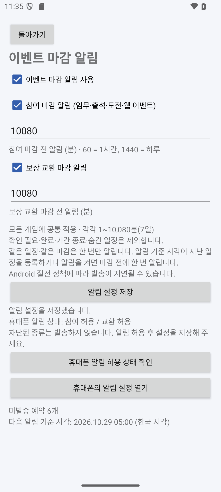
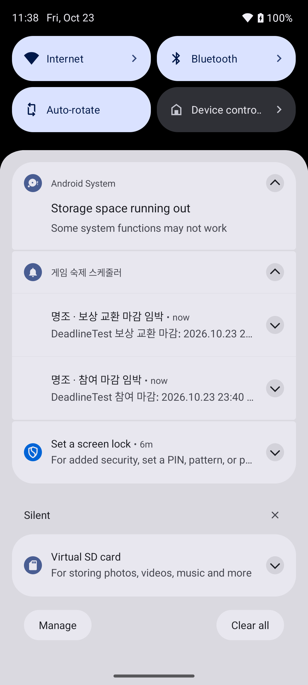

# 참여·보상 교환 마감 알림

앱 **0.5.0**부터 공식 일정과 직접 등록한 이벤트에 마감 알림을 제공한다. **참여 마감**과 **보상 교환 마감**을 별도의 알림 채널로 구분한다. 기본값은 알림 사용 안 함이다.

## 사용 방법

1. 홈 → **마감 알림 설정**을 연다.
2. **알림 권한 허용 요청**을 눌러 Android 알림을 허용한다. 이미 허용했거나 다시 요청할 수 없으면 **휴대폰의 알림 설정 열기**에서 앱과 각 채널의 허용 상태를 확인한다.
3. **이벤트 마감 알림 사용**을 켠다. 참여와 교환은 각각 켜거나 끌 수 있다.
4. 마감 몇 분 전에 받을지 각각 입력하고 **알림 설정 저장**을 누른다. 입력 범위는 **1~10,080분(7일)**이다. 예를 들어 참여 `1440`은 하루 전, 교환 `180`은 3시간 전이다. 모든 게임에 공통 적용하며, 이벤트별 개별 시점 지정과 여러 차례 반복 알림은 이번 범위에 없다.
5. 화면 아래에서 미발송 예약 개수와 다음 기준 시각을 확인한다. 0.8.0에서 알림을 누르면 이벤트 상세로 이동해 해당 참여 또는 교환 일정을 먼저 보여준다. 알림을 여는 동작은 완료 체크를 바꾸지 않는다.

| 설정 화면 | 참여와 교환 알림 |
| --- | --- |
|  |  |

스크린샷의 이벤트와 값은 동작 검증용이다. `10080`은 입력 가능 범위의 최댓값이며 실제 사용 권장값을 뜻하지 않는다.

## 어떤 일정에 알리는가

다음 조건을 모두 만족해야 한다.

- 사용자가 전체 알림과 해당 종류를 켰고 휴대폰의 앱·채널 알림을 허용했다.
- `timeShape=WINDOW`, `timeState=CONFIRMED`이고 시작·종료가 모두 있으며 시작이 종료보다 이르다.
- 최신 목록에서 빠지거나 숨겨진 일정이 아니고, 아직 종료되지 않았다.
- 현재 체크 항목이 존재하며 전부 완료한 상태가 아니다. 참여 목표만 완료하고 보상을 안 받았다면 참여 마감 알림 대상에 남는다. 참여 카드와 교환 카드의 완료 여부는 각각 판단한다.

`NEEDS_REVIEW`인 일정은 종료 시각만 알아도 제외한다. 누락된 시각을 추정하지 않는다. 일일 숙제 완료 여부는 이벤트 전체의 참여·교환 완료로 간주하지 않는다. 콘텐츠 업데이트 순간 알림(`INSTANT`)도 마감 알림에서 제외한다.

참여 종류는 `PLAY`, `ATTENDANCE`, `CHALLENGE`, `WEB`이며 교환은 `SHOP`이다. 따라서 출석·도전·웹 이벤트의 참여 마감도 참여 설정을 따른다.

## 시점·변경·중복 규칙

```text
기준 시각 = max(해당 단계의 시작, 해당 단계의 종료 - 설정한 분)
발송 가능 = 기준 시각 <= 현재 < 종료
발송 식별자 = (이벤트 단계 ID, 실제 종료 시각)
```

참여와 교환의 종료는 서로 다른 행에 저장되어 독립적으로 계산한다. 설정한 시점이 시작보다 빠르면 시작 이후에 알린다. 기준 시각을 이미 지난 일정을 새로 등록하거나 설정을 켠 경우, 아직 마감 전이면 한 번 알린다. 늦게 도착한 알람이 마감 후라면 발송하지 않는다.

알림을 게시한 뒤 Room에 발송 기록을 저장한다. 같은 단계·같은 종료 시각은 앱 재실행·중복 콜백·시점 설정 변경으로 다시 발송하지 않는다. 체크를 해제하거나 알림을 껐다 켜도 이미 발송한 마감은 반복하지 않는다. 기간 수정으로 실제 종료 시각이 바뀌면 새로운 마감으로 취급한다. 이미 표시된 이전 마감 알림은 제거한다.

이벤트 제목·기간 수정, 체크 변경, 공식 JSON 갱신, 설정 변경을 Room Flow로 감지해 다시 계산한다. 확인 필요·완료·숨김으로 바뀐 경우에는 예약 대상에서 빼고 이미 표시된 알림도 제거한다. 체크 기록과 일일 완료 이력은 알림 처리에서 수정하지 않는다.

## Android 예약과 한계

`AlarmManager.setAndAllowWhileIdle`로 가장 가까운 미발송 시각 한 건을 예약하고, 콜백에서 DB를 다시 읽어 해당 시점에 필요한 알림을 모두 판단한 뒤 다음 시각을 예약한다. 오래된 Intent의 제목·기간을 그대로 신뢰하지 않는다. 상시 서비스와 네트워크 연결은 필요 없다.

이는 **정확한 시각을 보장하는 알람이 아니다**. Android 절전·Doze·제조사 정책으로 지연될 수 있다. 마감 직전의 짧은 설정은 발송이 늦어 마감 후 제외될 수 있다. 정확한 알람 특별 권한은 요청하지 않는다. 기본 참여 하루 전·교환 3시간 전을 사용하거나 충분한 여유를 두고 설정한다. [Android 알람 예약 안내](https://developer.android.com/develop/background-work/services/alarms)를 따른다.

재부팅, 앱 업데이트, 기기 시각·시간대 변경 후에는 시스템 BroadcastReceiver로 재예약한다. 기기의 시간대를 바꿔도 저장된 UTC 마감 자체는 바꾸지 않으며 화면은 한국 시각을 사용한다. 일반적인 프로세스 종료와 앱의 **강제 중지**는 다르다. 강제 중지한 앱은 Android가 실행을 제한하므로 다시 열어야 한다. 기기 전원 꺼짐·권한 차단 중에는 알리지 않고, 다시 사용 가능할 때 아직 마감 전인 일정만 판단한다. Android 13 이상은 [POST_NOTIFICATIONS 권한](https://developer.android.com/develop/ui/views/notifications/notification-permission)이 필요하다.

알림 게시와 SQLite 커밋은 Android 전체에 걸친 하나의 트랜잭션이 아니므로 OS/프로세스가 그 사이에 종료되는 극단적 상황까지 정확히 한 번 발송을 보장하지는 않는다. 동일한 알림 태그·ID와 `onlyAlertOnce`를 사용하고 DB 발송 기록으로 일반적인 재실행·재예약 중복을 방지한다.

## Room v5와 기록 보존

스키마 5는 기존 9개 테이블을 유지하고 다음 두 테이블을 추가한다.

| 테이블 | 키와 내용 | 갱신 주체 |
| --- | --- | --- |
| `deadline_settings` | `id=1` PK, 전체/종류별 사용 여부, 참여·교환 사전 알림 분 | 사용자가 설정 저장 |
| `deadline_receipts` | `(eventKey, deadlineAt)` 복합 PK, 게시 시각 `deliveredAt`, 이벤트 FK `RESTRICT` | 알림 게시 성공 시 |

4→5는 테이블 추가만 수행하며 기존 이벤트·템플릿·체크·회차 기록은 변경하지 않는다. 이전 버전에서 업그레이드하면 기본 알림은 꺼져 있다. 공식 카탈로그는 알림 설정과 발송 이력에도 쓰지 않는다. 기존 APK를 삭제하지 않고 업데이트한다.

## 검증

Android 테스트 **66개**가 통과했다. 기존 44개에 알림 정책·저장·마이그레이션 18개, Android 알림 채널·권한·탭 Intent·AlarmManager 4개를 추가했다. 다음을 검증한다.

- 참여/교환 개별 시점과 스위치, 미정/종료/숨김/완료/순간 일정 제외
- 기준 시각 직전 미발송과 도달 시 발송, 늦은 콜백의 종료 일정 제외
- 제목·기간·시점 설정 변경, 완료/해제, 표시 알림 제거, 발송 실패 재시도
- 동시 콜백·코디네이터 재생성 시 중복 방지, 공식 갱신 후 개인 데이터 보존
- 실제 v4 스키마의 v5 업그레이드와 기존 v1/v2/v3 업그레이드 경로
- Android 13 권한 거부, 종류별 채널 차단, 알림 종류와 해당 게임/단계 이동 Intent, 단일 알람 교체·취소

API 35 에뮬레이터에서 기존 앱 업데이트 후 이벤트 체크·일일 기록 보존, 실제 권한 요청, 참여·교환 알림 표시와 탭 이동, 완료 후 알림 제거·재실행 시 중복 방지를 확인했다. 앱을 홈으로 보내고 프로세스를 종료한 뒤에도 OS 예약 콜백이 앱을 다시 실행해 알림을 게시하는 것을 확인했다. 에뮬레이터 재부팅 후 앱을 직접 열지 않아도 다음 예약이 복구되는 것을 확인했다. 2026-10-24 사용자가 휴대폰 기본 알림 시험과 재부팅 추가 시험을 정상으로 확인했다. 기종·도착 시각·절전 설정은 미제공이며 모든 제조사의 환경을 검증한 것으로 확대하지 않는다. [사용자 확인 기록](phone-test-checklist.md)을 참고한다.

관련 코드: [정책](../android/app/src/main/java/kr/ac/jeiu/gamescheduler/notifications/DeadlinePolicy.kt), [발송·예약 조정](../android/app/src/main/java/kr/ac/jeiu/gamescheduler/notifications/DeadlineCoordinator.kt), [Android 알림·수신기](../android/app/src/main/java/kr/ac/jeiu/gamescheduler/notifications/AndroidDeadlines.kt), [Room v5](../android/app/schemas/kr.ac.jeiu.gamescheduler.data.SchedulerDatabase/5.json).

[README](../README.md) · [Android Studio 실행](android-implementation.md) · [이벤트 등록·수정](manual-events.md)
