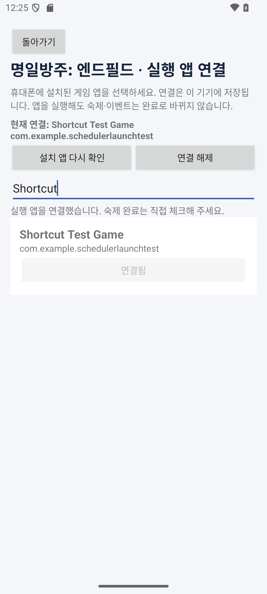
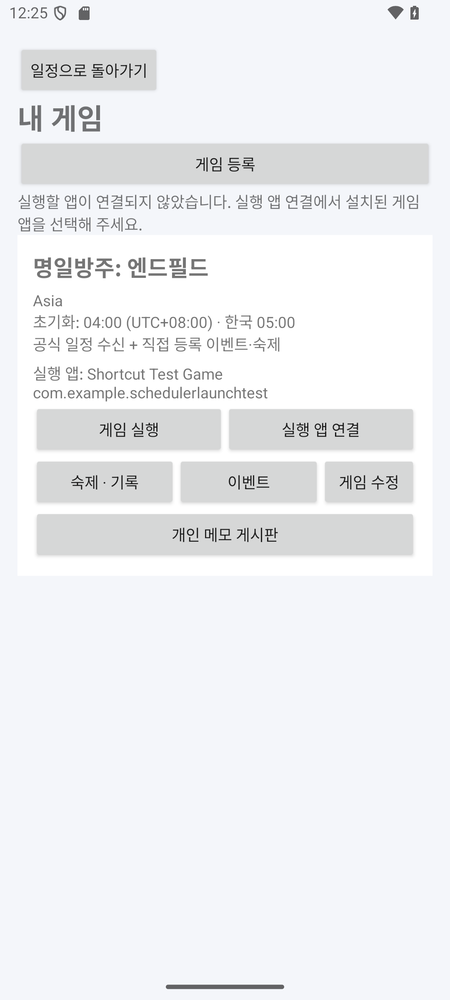
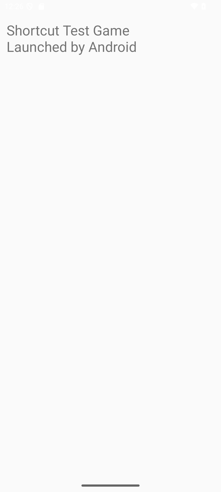
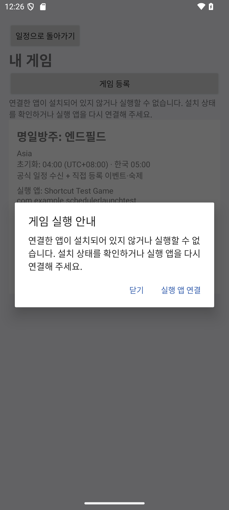

# 설치된 게임 앱 연결과 실행 바로가기

앱 **0.7.0**부터 게임별로 이 휴대폰에 설치된 실행 앱을 연결한다. **게임 실행은 숙제나 이벤트 완료를 뜻하지 않는다.** 플레이 결과와 보상 수령 여부는 사용자가 직접 체크한다.

## APK와 연결하는 방식

APK는 Android 앱의 설치 파일이다. 게임 APK를 설치하면 Android가 그 앱의 패키지명과 실행 화면을 관리한다. 스케줄러에는 사용자가 선택한 **패키지명**과 표시 이름을 저장한다. 예를 들어 `com.example.game`은 설명용 식별자이며 실제 명조·엔필·소전2의 패키지명을 뜻하지 않는다.

```text
게임 APK 설치 → Android에 앱 등록
스케줄러에서 설치된 게임 선택 → 게임 프로필에 패키지명 저장
게임 실행 버튼 → PackageManager.getLaunchIntentForPackage(패키지명)
              → Android startActivity → 설치된 게임의 실행 화면
```

스케줄러 APK에 게임 APK를 포함하거나 APK 파일 경로를 저장하지 않는다. 같은 패키지명으로 게임이 업데이트되면 현재 실행 화면을 다시 조회한다. 패키지명이 다른 한국판·글로벌판·다른 유통사 버전은 실제 설치 목록에서 각각 골라야 한다. 앱을 설치하는 기능과 게임 계정·인게임 진행도를 읽는 기능은 제공하지 않는다.

## 사용 방법

1. 게임을 이 기기에 설치한다. 스케줄러의 홈 → **내 게임 · 이벤트와 숙제 등록** → 원하는 게임의 **실행 앱 연결**을 누른다.
2. 앱 이름이나 패키지명으로 검색하고 설치된 게임의 **이 앱 연결**을 누른다. 게임으로 분류되지 않은 앱도 목록에 보일 수 있으므로 실제로 실행할 앱인지 확인한다.
3. 게임 목록으로 돌아가 **게임 실행**을 누르면 연결한 앱을 연다. 스케줄러로 돌아와 완료한 숙제·참여·보상을 직접 체크한다.
4. **실행 앱 연결**에서 다른 설치 앱을 선택하거나 **연결 해제**를 누를 수 있다. 변경·해제해도 기존 기록은 유지한다.

| 설치 앱 선택 | 게임별 바로가기 |
| --- | --- |
|  |  |

이미지의 `Shortcut Test Game`과 `com.example.schedulerlaunchtest`는 실행·삭제 검증용으로 만든 작은 테스트 앱이다. 실제 서비스 중인 게임의 실행을 검증했다고 해석하지 않는다.

| 실행 확인용 테스트 앱 | 삭제 후 실행 안내 |
| --- | --- |
|  |  |

## 연결되지 않았거나 설치되지 않은 경우

- **미연결:** 설치된 게임 앱을 먼저 연결하라는 안내와 연결 화면으로 이동하는 버튼을 제공한다.
- **연결 후 삭제·사용 중지·실행 화면 없음:** 앱이 설치되어 있지 않거나 실행할 수 없다는 안내를 보여준다. Android의 조회 제한이나 사용 중지 때문에 실행할 수 없는 경우를 실제 미설치와 단정해서 구분하지 않는다.
- **기기 정책·권한에 의한 실행 제한:** 제한 설정을 확인하라는 안내를 보여준다. 실행 도중 앱이 삭제되어도 예외를 처리한다.

연결 앱이 사라져도 저장된 연결 정보를 자동 삭제하지 않는다. 같은 패키지의 앱을 다시 설치하면 재연결 없이 사용할 수 있다. 사용자는 언제든 다른 앱을 고르거나 연결을 해제할 수 있다.

설치 목록은 현재 Android 사용자에서 실행 가능한 앱을 조회한다. 잠긴 별도 공간·업무 프로필·실행 아이콘이 없는 앱 등은 선택할 수 없을 수 있다. PC의 EXE나 노트북 게임을 실행하지 않는다. PC에서 플레이한 결과는 이 Android 앱에서 직접 체크한다.

## Android 조회와 저장 범위

Manifest의 `<queries>`에 `ACTION_MAIN + CATEGORY_LAUNCHER`를 선언해 실행 가능한 설치 앱을 조회한다. `QUERY_ALL_PACKAGES`나 APK 설치 권한은 요청하지 않는다. 자기 자신은 목록과 실행 대상에서 제외하고 같은 패키지의 여러 실행 아이콘은 한 번만 표시한다. 연결 직전과 실행 직전에 현재 실행 가능 여부를 다시 확인한다.

앱 이름·패키지 연결은 이 기기의 Room에만 저장하며 공개 JSON이나 GitHub로 업로드하지 않는다. 공식 일정 수신과 게임 이름·서버 설정 수정은 연결 필드를 덮어쓰지 않는다.

Room **스키마 7**은 기존 12개 테이블을 유지하고 `games`에 다음 두 컬럼을 추가한다.

| 컬럼 | 자료형·기본값 | 용도 |
| --- | --- | --- |
| `appPackageName` | TEXT NULL | 실행할 설치 앱의 패키지명 |
| `appLabel` | TEXT NULL | 연결할 때 확인한 앱 표시 이름 |

6→7 마이그레이션은 컬럼 추가만 수행한다. 기존 게임·이벤트·숙제·메모·알림 데이터는 유지하고 이전 게임의 연결 기본값은 미연결이다. 기존 v1~v6에서 v7로 가는 경로를 등록하며 파괴적 재생성을 사용하지 않는다.

연결 변경은 `GameAppRepository`가 게임의 위 두 컬럼만 갱신한다. 실행은 `GameAppLauncher`가 Android에 실행 요청만 전달하며 Room 쓰기 기능을 갖지 않는다. 따라서 **게임 실행 처리 자체는 체크·회차 완료·메모를 변경하지 않는다.** 알림은 기존 예약 규칙에 따라 독립적으로 동작한다.

## 검증

Android 테스트 **91개**가 통과했다. 기존 78개에 연결 저장·보존·업그레이드 7개, Android 설치 목록·실행 Intent·미설치·제한·체크 불변 6개를 추가했다. APK 빌드와 Lint 오류 0건을 확인했다.

검증 항목은 게임별 연결·변경·해제, 동일 앱의 여러 게임 연결, 잘못된 입력 거부, 공식 갱신·이름 수정·파일 DB 재실행 후 보존, 실제 v6→v7 업그레이드, 자기 자신/중지 앱 제외, 목록 중복 제거, 실제 대상 패키지와 `NEW_TASK` 플래그, 실행 중 삭제·기기 제한 예외 처리다. 실행 전후 미완료 이벤트가 미완료로 남는 것도 테스트한다.

API 35 에뮬레이터에서 테스트 앱을 직접 설치해 조회·연결·실행, 삭제 후 안내, 재설치·재실행 후 연결 재사용과 게임별 분리를 점검했다. 기존 완료 이벤트·일일 이력과 미완료 숙제가 실행 후에도 유지되는지 확인했다. 실제 명조·소전2·엔필 앱과 실물 휴대폰 검증은 남아 있다.

참고: [Android 패키지 조회 선언](https://developer.android.com/training/package-visibility/declaring), [PackageManager 실행 Intent](https://developer.android.com/reference/android/content/pm/PackageManager#getLaunchIntentForPackage(java.lang.String)), [다른 앱 실행과 예외 처리](https://developer.android.com/training/package-visibility/use-cases).

관련 코드: [실행·설치 목록](../android/app/src/main/java/kr/ac/jeiu/gamescheduler/GameAppLauncher.kt), [연결 저장](../android/app/src/main/java/kr/ac/jeiu/gamescheduler/data/GameAppRepository.kt), [선택 화면](../android/app/src/main/java/kr/ac/jeiu/gamescheduler/GameAppFragment.kt), [Room v7](../android/app/schemas/kr.ac.jeiu.gamescheduler.data.SchedulerDatabase/7.json).

[README](../README.md) · [Android 실행](android-implementation.md) · [개인 메모](personal-memos.md)
