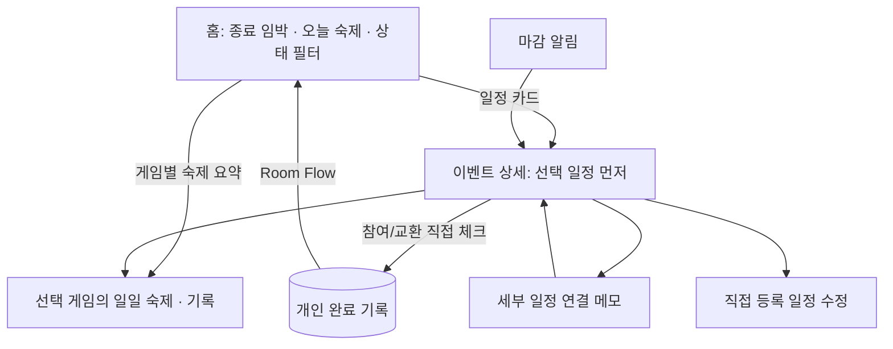
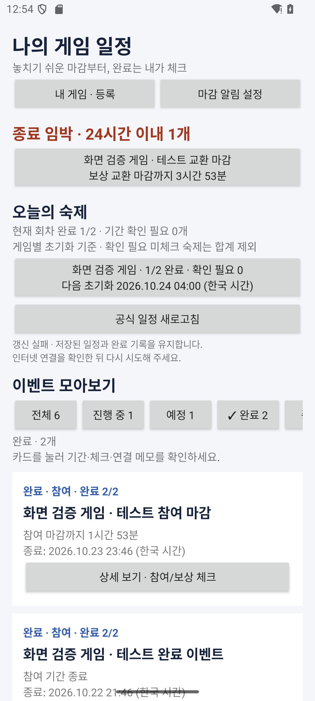
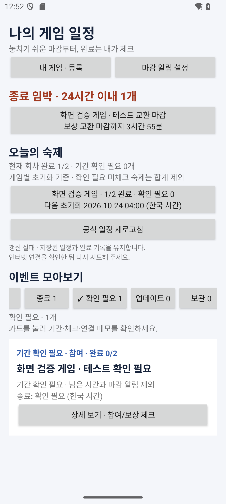
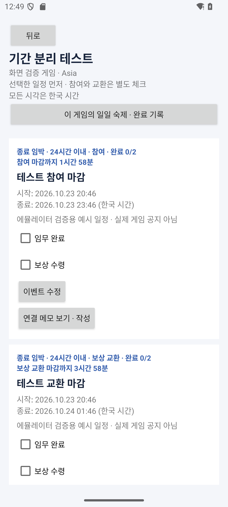
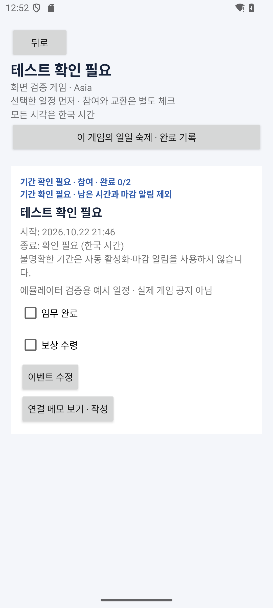

# 홈 대시보드와 이벤트 상세

앱 0.8.0에서 초기 설계의 홈 요약·상태별 조회와 `EventDetailFragment`를 구현했다. 화면의 기간은 한국 시각으로 표시하며, 일일 회차 계산은 각 게임에 저장한 서버 오프셋·초기화 시각을 사용한다.

## 홈 배치와 이동

1. **종료 임박**: 확정된 기간에 참여 중이고 체크가 남은 일정 중, 마감까지 24시간 이내인 항목을 마감 순서로 표시한다. 참여와 보상 교환을 별도 항목으로 취급한다. 상단에는 최대 3개를 표시하고 나머지는 진행 중 목록으로 이동한다. 해당 일정이 없으면 빈 상태 안내를 표시한다.
2. **오늘의 숙제**: 모든 등록 게임의 현재 회차 완료/대상 수와 기간 확인 필요 수를 요약한다. 게임 버튼을 누르면 해당 게임의 숙제·초기화 설정·이전 완료 기록으로 이동한다. 초기화 시각이 없는 게임은 설정 필요로 표시한다.
3. **이벤트 모아보기**: 전체·진행 중·예정·완료·종료·확인 필요·업데이트·보관 필터와 개수를 제공한다. 가로로 밀어 나머지 필터를 볼 수 있다. 카드에는 게임, 참여/교환 구분, 남은 시간, 종료 시각, 체크 진행률을 표시한다. 카드를 누르면 상세 화면으로 이동한다.

홈 전체를 `RecyclerView` + `ConcatAdapter`로 스크롤하므로 여러 게임을 등록하거나 글꼴을 크게 설정해도 하단 필터·목록으로 이동할 수 있다. 선택한 필터는 `SavedStateHandle`에 보관한다. 화면 복귀 시 즉시, 표시 중에는 30초마다 현재 시각을 다시 적용한다. 남은 분은 올림하며 기간 종료 시 음수 카운트다운을 표시하지 않는다.

## 상태 판정

상태는 DB에 별도 저장하지 않고 현재 메타데이터·개인 체크·시각에서 계산한다. 따라서 상태 필터를 바꾸는 일은 완료 기록을 변경하지 않는다.

| 우선순위 | 상태 | 판정 |
| --- | --- | --- |
| 1 | 보관 | 공식 공지에서 빠졌거나 사용자가 교환 일정을 숨김. 기존 체크 유지 |
| 2 | 업데이트 | 참여 기간이 아닌 INSTANT 콘텐츠 갱신 시점 |
| 3 | 확인 필요 | 미확정·누락·올바르지 않은 기간. 남은 시간과 마감 알림 제외 |
| 4 | 완료 | 현재 유효한 체크 항목이 1개 이상이며 모두 직접 체크함. 마감 후에도 완료 목록에 유지 |
| 5 | 종료 | 확정된 기간의 종료 시각 이상이고 체크가 남음 |
| 6 | 예정 | 시작 시각 전이고 체크가 남음 |
| 7 | 진행 중 | 시작 시각 이상, 종료 시각 미만이고 체크가 남음 |

기간 확인 필요는 체크를 모두 해도 확인 필요 목록에 남고 카드에 체크 진행률을 함께 표시한다. 제거된 이전 체크 항목은 현재 완료 판정에서 제외하고 상세에서 기록을 확인할 수 있다. 체크 항목이 없는 일정은 자동 완료로 간주하지 않는다. 진행 중은 마감 순, 예정은 시작 순, 완료·종료는 최근 마감 순이다.

## 오늘의 숙제 집계

- 게임마다 `DailyCycles.current()`로 현재 회차를 계산한다. 기기 자정이나 다른 게임의 초기화 시각을 공유하지 않는다.
- 사용 중인 개인 숙제와 현재 참여 가능한 확정 공식 숙제를 분모에 포함한다.
- 기간 확인 필요 미체크 공식 숙제는 **확인 필요 N개**로 별도 표시하고 분모에서 제외한다. 게임에서 참여 가능을 직접 확인해 이번 회차를 체크한 숙제는 완료/분모에 포함한다.
- 예정·종료·이전 공지·사용 중지 숙제의 미체크 항목은 분모에서 제외한다. 이미 이번 회차에 체크했다면 회차 종료까지 완료와 분모에 포함해 오늘 처리한 기록을 보여준다.
- 현재 회차 시작 시각과 일치하는 기록만 집계한다. 새 회차는 새 미완료로 집계하며 지난 회차의 행을 삭제하지 않는다.
- 초기화 미설정 게임은 합계에서 제외하며 설정 필요 버튼을 제공한다. 0/0은 대상이 없다는 의미이며 전체 완료로 처리하지 않는다.

## 이벤트 상세

선택한 세부 일정을 먼저 보여주고, 같은 게임·이벤트 묶음의 다른 참여/교환 일정을 이어서 표시한다. 각 일정에는 상태·정확한 기간·남은 시간·체크 진행률·완료 시각·주의사항·일일 숙제 템플릿을 표시한다.

- 참여 임무·보상 수령과 교환 완료 체크는 독립적이다. 홈 요약과 필터는 Room Flow로 갱신된다.
- **연결 메모 보기·작성**은 선택한 세부 일정에 연결된 메모만 보여준다. 메모의 이벤트 버튼으로 같은 상세 화면에 돌아갈 수 있다.
- **이 게임의 일일 숙제**는 해당 게임의 현재 회차와 기록을 연다.
- **공식 공지 보기**는 출처 URL이 있을 때 표시한다. 브라우저가 없으면 안내한다.
- 직접 등록한 이벤트만 수정 버튼을 제공한다. 기간·제목 수정은 기존 식별자와 개인 완료를 유지한다.
- 마감 알림을 누를 때도 해당 세부 일정의 상세 화면으로 이동한다. 알림을 누르거나 화면을 열어도 자동 완료되지 않는다.

## 검증과 실제 화면

순수 상태·집계 테스트 14개를 추가해 전체 105개 테스트가 통과했다. 정확한 시작/종료 경계, 24시간 마감 경계, 체크 없는 일정·이전 체크 제외, 상태 필터의 누락/중복, 미확정 기간, 게임별 UTC+8/+9 초기화 경계와 이전 기록 보존을 검증했다. APK 빌드와 Lint 오류 0건을 확인했다. DB 스키마는 7을 유지한다.

API 35 임시 에뮬레이터에서 v0.7 데이터 위에 업데이트 설치하고 홈·상세·필터·독립 체크·메모 이동·일일 기록·회전·재실행·저장된 기록 보존을 점검했다. 아래 스크린샷의 ‘화면 검증 게임’과 이벤트는 테스트용 예시이며 실제 공식 일정이 아니다. 이번 화면 점검에서는 에뮬레이터의 인터넷 연결이 실패하는 경우 저장 데이터가 유지되는 것도 확인했으며, 공식 메타데이터 갱신 시 보존은 기존 Room 수신 테스트로 검증했다.

2026-10-24 사용자가 실제 게임·휴대폰 기본 26개와 추가 4개 시험을 정상으로 확인했다. [체크리스트](phone-test-checklist.md)에 사용자 보고로 기록했으며 기종·시각·캡처는 미제공이다. 여러 제조사의 글꼴/화면 크기 검증, 명조·소전2 공식 수집과 배경 공지 갱신, 공식 일정 개인 수정·자유 체크 항목 편집은 후속 범위다.

[README](../README.md) · [초기 화면 설계](screen-design.md) · [Android 실행](android-implementation.md)
