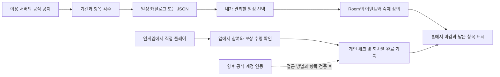

# 세 게임의 이벤트 입력과 완료 상태 연동 검토

김태준 · 2026626007 · 검토일 2026-10-23

## 제안하는 구현 방향

**공식 공지를 바탕으로 일정을 가져오고, 개인의 참여·보상 수령은 직접 체크하는 방식**을 기말 구현의 기준으로 삼는다. 일정 등록을 줄이는 자동화와 인게임 개인 진행을 읽는 자동화는 별도 기능이다. 후자는 게임사가 외부 앱에 제공하는 접근 방법과 데이터 범위를 확인한 뒤 추가한다.

이 문서는 연동 가능성을 조사한 설계 검토이다. 현재 Android 앱, 공지 수집 서버, 개인 계정 동기화는 구현되어 있지 않다.

이용 환경은 명조·엔필 Asia, 소전2 HAOPLAY 한국판으로 확정했다. 앱의 일정 자동 수신을 목표로 정하고 게임별 수집·세부 일정·숙제 등록을 [공지 수집 상세 설계](notice-ingestion-design.md)에 구체화했다. 아래의 계정 진행 연동 조사는 개인 완료 자동 판정을 기말 범위에 넣는다는 의미가 아니다.

## 두 종류의 데이터

| 구분 | 예시 | 정보가 있는 곳 | 이번 프로젝트의 처리 |
| --- | --- | --- | --- |
| 공통 일정 | 이벤트명, 참여 기간, 보상 교환 마감, 단계 개방일 | 이용 서버의 공식 공지 | 검수 후 등록, 이후 JSON 가져오기와 병합 |
| 개인 진행 | 내가 도전을 끝냈는지, 보상을 받았는지 | 내 게임 계정의 진행 기록 | 사용자가 직접 체크 |
| 개인 습관 | 매일 확인할 항목, 내가 원하는 목표, 메모 | 사용자 본인 | 게임별 프리셋을 선택·수정하여 저장 |

공지에 “임무를 완료하면 보상 지급”이라고 적혀 있어도 그것만으로 내가 완료했는지는 알 수 없다. 앱에서 게임을 실행하거나 다시 돌아온 사실도 완료의 근거가 되지 않는다.

## 게임별 조사 결과와 차이

| 게임 | 확인한 자료 | 확정할 수 있는 범위 | 이번 설계의 선택 |
| --- | --- | --- | --- |
| 명조 | [한국어 공식 버전 공지](https://wutheringwaves.kurogames.com/kr/main/news/detail/4615), [중국권 쿠로 커뮤니티의 자원 리포트 안내](https://www.kurobbs.com/mc/post/1375211214574608384) | 공지에서 세부 기간을 확인할 수 있다. 중국권 계정 연동 도구 안내도 있으나 한국·글로벌 계정 지원과 이벤트별 완료·보상 수령 조회는 확인하지 못했다. | 한국어 공지와 실제 이용 서버를 대조해 일정 등록. 개인 완료는 수동. 중국권 도구를 한국 계정용 API로 가정하지 않는다. |
| 소녀전선 2 | [한국 배급사 사이트의 게임 안내](https://gf2.haoplay.com/game/probability.html), [글로벌 운영사의 이벤트 공지 사례](https://gf2exilium.sunborngame.com/NewsInfo?id=435&typeId=4) | 참여 기간과 교환 기간이 다른 구조를 확인할 수 있다. 글로벌 공지의 날짜를 한국판에 그대로 적용할 수는 없다. 개인 이벤트 진행을 읽는 공식 외부 앱용 경로는 이번 조사에서 확인하지 못했다. | 한국판 공식 공지·카페와 서버를 먼저 확정한다. 임무·상점 일정을 분리하고 체크는 수동으로 처리한다. |
| 명일방주 엔드필드 | [공식 게임 도구 안내](https://endfield.gryphline.com/en-us/news/0755), [공식 도구 업데이트](https://endfield.gryphline.com/en-us/news/6187) | SKPORT의 Protocol Terminal과 위젯에서 이성·일일 과제 진행을, 업데이트된 위젯에서 주간 루틴을 볼 수 있다고 안내한다. 이것이 제3자 앱용 API나 모든 이벤트 보상 수령 조회를 보장하지는 않는다. | 공식 게임 도구로 이동해 확인할 수 있게 설계한다. 허용된 외부 접근 방법을 확인하면 일일 진행 항목부터 연동 실험의 우선 후보로 삼는다. |

공식 도구에 정보가 표시된다는 사실과 우리 앱이 그 정보를 받을 수 있다는 사실은 다르다. 위 자료들은 일정·도구의 구조를 확인한 근거이며, 세 게임의 현재 이벤트 데이터를 모두 확보했다는 의미는 아니다.

## 실제로 이벤트를 넣는 순서

1. **게임과 이용 환경 등록:** 게임, 서버·지역, 배급사 구분, 서버 시간대와 초기화 시각을 확인한다. 같은 게임의 다른 서버 일정이 섞이지 않도록 한다.
2. **공식 공지 확인:** 한국어 공지를 우선 확인하되 실제 이용 서버에 적용되는지 대조한다. 영구 콘텐츠, 광고·픽업 안내와 기한이 있는 숙제를 구분한다.
3. **일정을 작업 단위로 분해:** 참여 마감, 최종 보상 수령, 상점 교환 등 마감이 다른 작업은 별도 일정으로 만들고 같은 `groupKey`로 묶는다. 이벤트 안의 반복 목표는 연결된 `daily_tasks`로 만든다.
4. **관리할 항목 선택:** 사용자가 관심 있는 일정과 목표만 등록한다. 모든 공지를 자동으로 숙제로 만드는 방식은 피한다.
5. **개인 체크 생성:** 처음 가져올 때 선택한 프리셋으로 체크 항목을 만든다. 기존 이벤트를 갱신할 때는 사용자 체크를 재생성하거나 덮어쓰지 않는다.
6. **날짜 수정 반영:** 검수한 `sourceKey`로 같은 일정을 찾아 기간·출처만 갱신한다. 기간이 불명확하거나 직접 수정한 내용과 충돌하면 확인 대기로 둔다.

초기에는 직접 검수한 일정과 프리셋으로 시작한다. 이후 공개 저장소의 일정 JSON을 가져오는 방식으로 등록 수고를 줄일 수 있다. 공지 자체의 자동 수집은 그 다음 단계이며, 현재 운영 중인 자동 일정 배포 서비스는 없다.

### 하나의 이벤트를 나누는 예시

아래는 실제 진행 중인 이벤트가 아닌 설계용 예시다.

| 항목 | 저장 위치 | 언제 체크하는가 |
| --- | --- | --- |
| 이벤트 A의 스테이지 참여 마감 | `events`의 첫 일정 | 선택한 스테이지 목표를 실제로 달성한 뒤 |
| 이벤트 A의 상점 교환 마감 | 같은 `groupKey`의 두 번째 일정 | 원하는 교환 보상까지 받은 뒤 |
| 이벤트 기간 중 매일 하는 목표 | 첫 일정에 연결한 `daily_tasks` | 해당 서버 회차에서 끝낸 뒤 |
| 누적 보상 수령 | 해당 일정의 `event_check_items` | 수령까지 확인한 뒤 |

“오늘 일퀘 완료”로 이벤트 A의 최종 보상까지 완료 처리하지 않는다. 참여가 끝나도 보상 수령 항목이 남으면 홈에서 계속 확인할 수 있게 한다.

## 수동 체크가 또 다른 숙제가 되지 않도록

- 게임별로 자주 하는 숙제 프리셋을 한 번 선택하고, 매번 제목과 기간을 다시 쓰지 않게 한다.
- 홈에서 일일 숙제를 바로 체크하되, 이벤트 참여와 최종 보상 수령은 따로 표시한다.
- 여러 항목을 한 번에 체크할 때도 사용자가 선택한 항목을 보여주고 되돌릴 수 있게 한다. 일퀘 일괄 체크가 이벤트 완료에 영향을 주면 안 된다.
- 모바일 게임 바로가기로 진입했다가 돌아오면 “완료한 항목 확인”을 제안할 수 있다. 확인 없이 체크하거나 앱이 열릴 때마다 반복해서 묻지 않는다.
- PC에서 플레이한 경우에도 같은 체크 화면을 사용한다. 휴대폰 앱만으로 노트북의 게임 진행을 관측할 수 있다고 가정하지 않는다.
- 처음 체크되지 않은 상태는 “게임에서 안 했다”는 판정이 아니라 “아직 이 앱에서 확인하지 않았다”는 뜻이다. 사용자 확인 시각을 함께 보여 오해를 줄인다.

## 인게임 완료 자동 반영의 조건

| 방법 | 판단 | 필요한 조건과 한계 |
| --- | --- | --- |
| 공식 계정 연동·API | 후속 검증 대상 | 해당 서버 지원, 사용자의 공식 인증, 제3자 앱 사용 허용, 이벤트·목표·보상 수령 필드의 실제 제공 여부 |
| 공식 도구로 이동 | 가까운 확장 후보 | 원문과 진행을 확인할 수 있지만, 도구를 열었다고 우리 앱의 기록을 자동으로 바꾸지는 않는다. |
| 사용자가 고른 스크린샷 OCR | 선택적 후속 기능 | 보이는 문구로 체크 후보를 만들고 사용자 확인 후 반영한다. 사진에 없는 항목이나 보상 수령을 추정하지 않는다. |
| 게임 실행·플레이 시간 감지 | 완료 근거로 사용하지 않음 | 게임을 열었다는 정보만으로 특정 이벤트나 보상을 끝냈다고 판단할 수 없다. |

Android 앱은 다른 앱의 데이터와 프로세스에서 격리된다. 따라서 우리 앱에 실행 버튼을 넣었다는 이유로 게임의 내부 기록을 직접 읽을 수는 없다. 이는 [Android Application Sandbox](https://source.android.com/docs/security/app-sandbox)의 동작을 이 설계에 적용한 판단이다. PC 플레이까지 지원하려면 공식 계정 데이터나 별도의 사용자 제공 근거가 필요하다.

엔드필드 운영사는 [비공식 도구 로그인에 대한 안내](https://endfield.gryphline.com/en-us/news/7026)도 제공하고 있다. 기말 버전에는 게임 비밀번호나 로그인 쿠키를 붙여넣는 기능을 넣지 않는다. 개인 자동 연동은 공식적으로 허용된 인증·데이터 경로를 확인한 뒤 검토한다.

## Room과 데이터 처리에 미치는 영향

기말의 기본 6개 테이블은 유지한다. `events.syncPolicy`의 AUTO는 **일정 메타데이터 갱신 방식**을 뜻하며, 개인 완료 상태가 자동 판정된다는 뜻이 아니다.

| 데이터 | 갱신 주체 | 보존 규칙 |
| --- | --- | --- |
| `events`의 기간·제목·출처 | 사용자 또는 검수된 일정 JSON | 동일 `eventId` 유지, 충돌은 검토 대기 |
| `event_check_items`의 완료 상태 | 사용자 | 일정 갱신 시 덮어쓰지 않음 |
| `daily_task_records` | 사용자와 서버 회차 계산 | 현재 회차만 추가·해제, 과거 기록 보존 |
| `memos` | 사용자 | 공지 갱신과 분리 |

실제 개인 연동을 추가할 때는 계정·서버 연결, 항목 매핑, 원본 관측 시각, 갱신 성공 여부와 완료 근거를 별도로 설계해야 한다. 조회 실패는 미완료가 아니며, 오래된 조회 결과도 최신 확정 상태와 구별해야 한다. 현재의 `isDone` 값만으로 수동 확인과 공식 조회를 뒤섞지 않는다.

## 개발 순서와 확인 기준

1. **필수:** 수동 일정·체크·메모와 회차 기록 보존을 완성한다.
2. **앱 목표:** 검수된 일정 JSON을 가져와 등록·기간 수정의 반복 입력을 줄인다. 다시 가져와도 개인 체크가 유지되어야 한다.
3. **공식 경로 검토:** 엔드필드 도구를 우선 조사하되, 외부 접근 방법을 확인하기 전에는 인게임 자동 반영을 구현 완료로 표시하지 않는다.
4. **후속:** 지원되는 항목에 한해 공식 진행 연동 또는 스크린샷 확인 보조를 검토한다. 주간 반복 회차는 일일 회차와 별도 후속 설계로 둔다.

검증할 대표 상황은 “일퀘는 끝났지만 보상은 미수령”, “PC에서 플레이”, “참여와 교환 마감이 다름”, “같은 JSON 재수신”, “공식 도구의 갱신 지연”, “이용 서버 불일치”이다.

[README로 돌아가기](../README.md)
