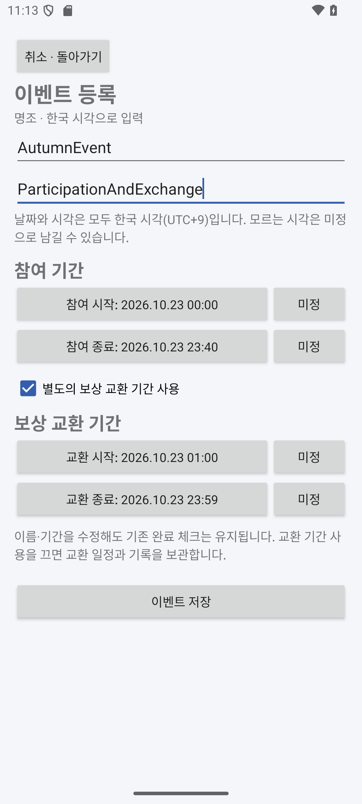
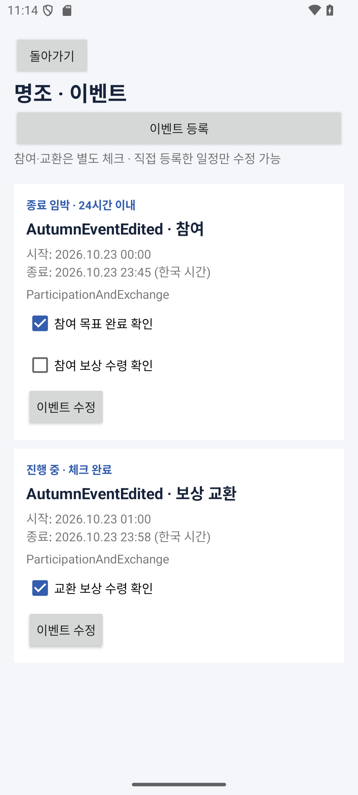

# 이벤트 직접 등록·수정: 참여와 보상 교환

앱 **0.4.0**부터 등록한 모든 게임에 이벤트를 직접 추가할 수 있다. 엔필 공식 프로필에도 개인 이벤트를 만들 수 있으며, 명조·소전2는 공식 수집기 없이 직접 입력한 일정으로 사용할 수 있다.

## 사용 방법

1. 홈 → **내 게임 · 이벤트와 숙제 등록** → 원하는 게임의 **이벤트** → **이벤트 등록**으로 이동한다.
2. 이벤트 이름과 메모를 입력하고 참여 시작·종료를 설정한다. 날짜·시각은 모두 **한국 시각(UTC+9)**으로 입력한다. 게임의 일일 초기화 시간 기준과 별개다.
3. 교환 마감이 따로 있으면 **별도의 보상 교환 기간 사용**을 켜고 교환 시작·종료를 지정한다. 참여 중에 교환이 열릴 수 있으므로 두 기간의 겹침을 허용한다.
4. 저장하면 **참여**와 **보상 교환** 카드가 따로 나타난다. 참여 카드에는 목표 완료와 보상 수령, 교환 카드에는 교환 보상 수령 체크가 있다. 한 카드의 체크가 다른 카드를 완료로 바꾸지 않는다.
5. 직접 등록한 카드의 **이벤트 수정**으로 이름·메모·두 기간을 바꾼다. **기존 완료 여부와 완료 시각은 유지**한다. 실제로 미완료가 된 작업은 사용자가 직접 체크를 해제한다.

| 날짜·시각 입력 화면 | 저장·수정 후 완료 상태 |
| --- | --- |
|  |  |

이미지의 이벤트 이름·날짜는 UI 검증용 입력값이다. 실제 게임의 공식 이벤트 정보가 아니다.

모르는 시작·종료는 **미정**으로 비워둘 수 있다. 한쪽이라도 비어 있으면 NULL과 `NEEDS_REVIEW`로 저장하고 **기간 확인 필요**로 표시한다. 진행 중으로 추정하거나 카운트다운에 사용하지 않는다. 나중에 기간을 확정해도 체크는 보존한다. 각 기간의 양끝이 모두 있으면 종료가 시작보다 뒤인지 검사하며, 오류가 있으면 저장하지 않고 입력 화면에 이유를 표시한다.

취소는 입력을 버리고 돌아간다. 저장에 실패하면 입력을 유지한다. 편집 중 회전·프로세스 재생성에는 `SavedStateHandle`로 입력을 복원한다. 공식 수신 일정은 원문 근거를 유지하며 이번 편집 화면에서는 수정하지 않는다.

## 기간을 수정해도 체크가 유지되는 이유

이벤트를 처음 저장할 때 `user-event:<UUID>` 묶음 ID를 만들고 다음 키를 고정한다. 제목과 날짜는 키에 포함하지 않는다.

| 구분 | 일정 PK (`events.sourceKey`) | 체크 키 (`sourceItemKey`) |
| --- | --- | --- |
| 참여 | `<묶음 ID>:play` | `goal`, `rewards` |
| 교환 | `<묶음 ID>:shop` | `wanted-exchanges` |

`check_records`는 `(eventKey, sourceItemKey)`로 완료와 완료 시각을 저장한다. 수정은 같은 ID로 `events`·`check_templates` 메타데이터만 Upsert하고 완료 테이블에는 쓰지 않는다. 같은 제목의 다른 이벤트는 UUID가 달라 서로 영향을 주지 않는다. 게임 소속을 바꾸거나 기존 이벤트를 삭제하는 기능은 이번 범위에 없다.

처음에 교환 기간 없이 등록했다가 나중에 추가할 수 있다. 이미 존재하는 교환 기간 사용을 끄면 교환 행을 삭제하지 않고 **교환 일정 숨김 · 기록 유지**로 목록 아래에 보관한다. 보관 중에는 체크를 변경할 수 없다. 다시 켜면 같은 키와 이전 날짜·완료 체크가 복원된다. 참여 기록도 유지된다.

## 공식 수신과 DB 업그레이드

앱 0.4의 DB **스키마 4**는 9개 테이블을 유지하며 `events.isUserCreated` 컬럼을 추가한다. 3→4 마이그레이션 기본값은 `false`이므로 기존 공식 일정의 의미를 바꾸지 않는다. 1→2→3→4 경로를 등록하고 파괴적 재생성은 사용하지 않는다. 기존 앱을 제거하지 않고 새 APK로 업데이트한다.

공식 수신의 누락 처리·템플릿 갱신은 `isUserCreated=false` 일정만 대상으로 한다. 엔필 공식 프로필 아래 만든 개인 일정도 보호한다. 공식 피드가 개인 일정 키를 덮어쓰려 하면 트랜잭션을 거부한다. 홈은 모든 게임의 이벤트를 모아 기존 마감 우선순위로 정렬하고, 게임별 이벤트 화면은 해당 게임만 조회한다.

```text
게임의 이벤트 목록 → 등록/수정 → EventEditorViewModel
  → 입력 검증 → ManualEventsRepository → Room 트랜잭션
  → events·check_templates 갱신 (check_records 보존)
  → Room Flow → 게임별 목록과 홈 갱신
완료 체크 → CatalogRepository.setChecked → check_records만 갱신
공식 JSON → CatalogRepository.refresh → 공식 소유 일정만 병합
```

0.5는 알림 설정·발송 이력을 추가한 [스키마 5](deadline-notifications.md)를 사용했으며, 현재 0.6은 [개인 메모](personal-memos.md)를 추가한 스키마 6을 사용한다. 아래 결과는 이벤트 편집 기능을 처음 추가한 0.4 버전의 검증이며, 현재 테스트는 기존 업그레이드 경로까지 v6으로 실행한다.

## 검증

- Android 단위 테스트 **44개**: 기존 34개와 수동 이벤트 테스트 10개. 독립 기간·체크, 제목/기간 수정 시 정확한 완료 레코드 보존, 교환 추가/보관/복원, 잘못된 기간의 전체 저장 거부, 미정 기간, 공식 갱신 격리, 잘못된 게임·공식 일정 편집 거부, 파일 DB 재실행, v3→v4 마이그레이션을 검증했다. v1/v2 업그레이드 테스트도 v4까지 실행한다.
- APK 빌드 성공, Lint 오류 0건.
- API 35 에뮬레이터에서 v0.3→v0.4 업데이트 후 기존 공식 체크·일일 기록 보존, 날짜/시각 선택, 참여·교환 등록, 각각 체크, 이름/기간 수정 후 체크 유지, 교환 보관/복원, 공식 새로고침·프로세스 재실행 후 보존을 확인했다. 메타데이터가 실제 변경되는 공식 갱신은 로컬 피드·Room 테스트로 검증했다.

관련 코드: [수동 이벤트 저장](../android/app/src/main/java/kr/ac/jeiu/gamescheduler/data/ManualEventsRepository.kt), [편집 상태](../android/app/src/main/java/kr/ac/jeiu/gamescheduler/EventEditorViewModel.kt), [Room v4](../android/app/schemas/kr.ac.jeiu.gamescheduler.data.SchedulerDatabase/4.json), [보존 테스트](../android/app/src/test/java/kr/ac/jeiu/gamescheduler/ManualEventsTest.kt).

[Android 실행](android-implementation.md) · [게임·숙제 등록](manual-registration.md) · [README](../README.md)
