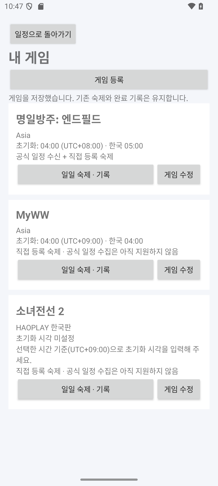
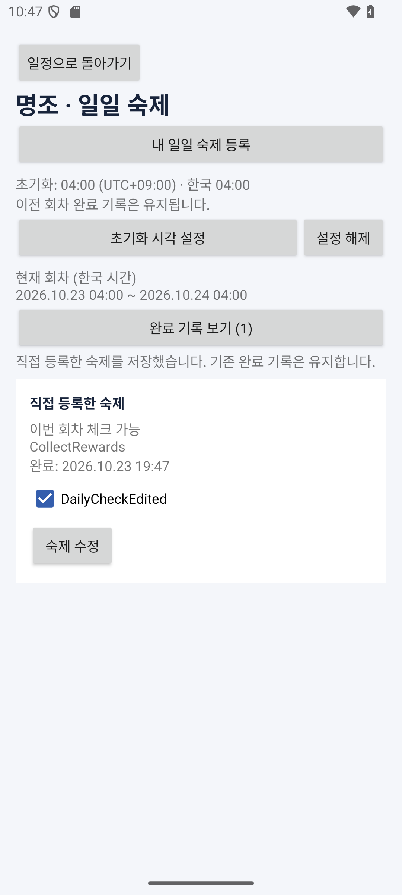

# 게임·일일 숙제 직접 등록과 수정

앱 0.3.0부터 **내 게임 · 게임과 숙제 등록**에서 게임별 숙제를 관리한다. 명조·소녀전선 2·엔필 이름 예시와 직접 입력을 제공한다. 공식 일정 자동 수집은 아직 엔필 Asia만 지원하며, 명조·소전2는 이 화면에서 직접 만든 숙제를 사용한다.

## 사용 순서

1. 홈 → **내 게임 · 게임과 숙제 등록** → **게임 등록**을 누른다.
2. 이름 예시를 선택하거나 게임 이름·서버/지역을 입력한다. 명조 Asia, 소전2 HAOPLAY 한국판을 쉽게 입력할 수 있다.
3. 초기화 시각을 입력할 시간 기준을 선택한다. 한국 시각으로 입력하려면 **UTC+9**, 서버 UTC+8 시각으로 입력하려면 **UTC+8**을 선택한다. UTC+0도 지원한다. 게임 이름 선택이 실제 초기화 시각이나 시간대를 자동 확정하지 않는다.
4. 게임 카드의 **일일 숙제 · 기록** → **초기화 시각 설정**에서 직접 확인한 시각을 입력한다.
5. **내 일일 숙제 등록**에서 이름·설명·사용 여부를 저장한다. 등록한 항목은 **숙제 수정**으로 바꿀 수 있다.
6. 현재 회차의 숙제를 체크하고 **완료 기록 보기**에서 이전 기록을 확인한다. 다른 게임에서도 같은 이름을 사용할 수 있으며 완료 기록은 각각 분리된다.

게임의 표시 이름·서버 메모·시간 기준을 수정해도 게임 ID와 숙제 ID는 유지한다. 숙제를 수정할 때도 같은 ID를 사용한다. 숙제의 게임 소속을 다른 게임으로 옮기는 기능과 삭제 기능은 이번 범위에 없다. 사용을 중지하면 새 완료를 막고 기존 기록을 보관한다. 중지한 숙제의 현재 회차 체크는 해제할 수 있다.

공식 엔필 프로필은 서버 혼동을 막기 위해 **Asia / UTC+8**을 유지한다. 표시 이름과 초기화 시각, 직접 만든 숙제는 바꿀 수 있다. 다른 엔필 서버를 개인 게임으로 등록할 수는 있지만 공식 피드를 자동으로 연결하지 않는다.

| 내 게임 | 직접 만든 숙제 |
| --- | --- |
|  |  |

스크린샷의 영어 이름·설명·초기화 값은 앱 동작 확인을 위한 입력값이며 실제 게임 임무나 공식 초기화 시각을 안내하지 않는다.

## 공식 갱신과 개인 데이터의 분리

Room DB 버전은 **3**이다. 기존 7개 테이블을 유지하고 다음 두 테이블을 추가했다.

| 테이블 | 고정 키·내용 | 갱신 주체 |
| --- | --- | --- |
| `personal_daily_tasks` | `taskId` PK, 게임 FK·숙제 이름·설명·사용 여부 | 사용자 등록·수정만 |
| `personal_daily_records` | `(taskId, cycleStartAt)` PK, 완료 시각·당시 초기화 분·당시 시간 기준 | 사용자 회차 체크만 |

직접 등록한 게임과 숙제는 UUID 기반의 별도 ID를 한 번 배정한다. 제목을 키로 쓰지 않는다. 개인 숙제는 공식 `events`나 `daily_tasks`를 부모로 사용하지 않고 `games`에 직접 연결하므로, 공식 이벤트가 사라지거나 숙제 템플릿이 바뀌어도 영향을 받지 않는다.

공지 수신기는 엔필 공식 일정·공식 템플릿만 갱신한다. 개인 숙제와 개인 완료 테이블에는 쓰지 않으며, 같은 엔필 프로필 아래 만든 개인 숙제도 보호한다. 게임 최초 생성은 `IGNORE`를 사용해 기존 이름·초기화 설정을 덮어쓰지 않는다.

수정은 기존 행의 메타데이터만 UPDATE한다. 부모 행을 삭제·재삽입하거나 완료 기록을 새 숙제 ID로 복사하지 않는다. 게임 이름·숙제 제목이 바뀌면 기록 목록의 표시 이름은 갱신되지만 원래 회차와 완료 시각은 유지한다.

새 회차에는 이전 기록을 지우지 않고 새 회차 키로 완료 여부를 조회한다. 설정이나 시간 기준 변경으로 회차가 달라져도 이전 기록을 이동하지 않는다. 저장 직전 현재 회차·게임 소속·숙제 사용 여부를 다시 검사하며, 다른 게임의 숙제나 오래된 화면에서 보낸 회차 체크는 거부한다.

관련 코드: [개인 등록·수정](../android/app/src/main/java/kr/ac/jeiu/gamescheduler/data/PersonalizationRepository.kt), [회차 체크](../android/app/src/main/java/kr/ac/jeiu/gamescheduler/data/DailyRepository.kt), [내 게임 화면](../android/app/src/main/java/kr/ac/jeiu/gamescheduler/GamesFragment.kt).

## 기존 앱 업그레이드와 검증

2→3 마이그레이션은 게임의 서버 표시·개인 등록 여부 컬럼과 개인 테이블 두 개를 추가한다. 기존 일정·참여 체크·일일 완료·초기화 설정은 삭제하지 않는다. 1→2→3 업그레이드 경로도 유지한다. [실제 스키마 v3](../android/app/schemas/kr.ac.jeiu.gamescheduler.data.SchedulerDatabase/3.json)를 버전 관리한다. 기존 앱은 삭제하지 않고 새 APK로 업데이트한다.

총 **34개 Android 테스트**(기존 수신 12, 회차 14, 개인 등록·수정 8)가 통과했다. 같은 이름의 게임·숙제 구분, 이름/설명/사용 여부 수정 후 완료 보존, 시간 기준 변경, 잘못된 소속의 수정·체크 거부, 파일 DB 재실행, 실제 v1/v2 스키마의 업그레이드를 검증했다. 새 공식 피드가 이벤트를 제거하는 경우에도 엔필 개인 숙제와 명조 숙제·기록이 그대로 남는 것을 확인했다.

API 35 에뮬레이터에서도 기존 0.2.0 앱의 체크·일일 기록을 업그레이드해 보존하고, 명조·소전2 등록, 숙제 생성·수정·체크, 게임 이름 수정, 같은 이름의 숙제 분리, 공식 새로고침·프로세스 재실행 후 개인 데이터 보존을 확인했다. Lint 오류는 0건이다.

## 공개 저장소와 학교 제출물

README와 공개 설명 문서에서 이름·학번을 제외했다. 개인정보가 포함된 학교 제출용 Word·PDF도 현재 공개 파일과 배포 ZIP에서 제외하고 로컬 학교 제출용 폴더에 보관한다. 과제 양식은 학교 내 사이트에 제출한다. 과거 커밋 이력을 다시 쓰는 작업은 수행하지 않았으므로 이전 이력의 제출 파일과 Git 작성자 정보는 남아 있다.

[Android Studio 실행 방법](android-implementation.md) · [일일 회차 규칙](daily-tasks.md) · [README](../README.md)
