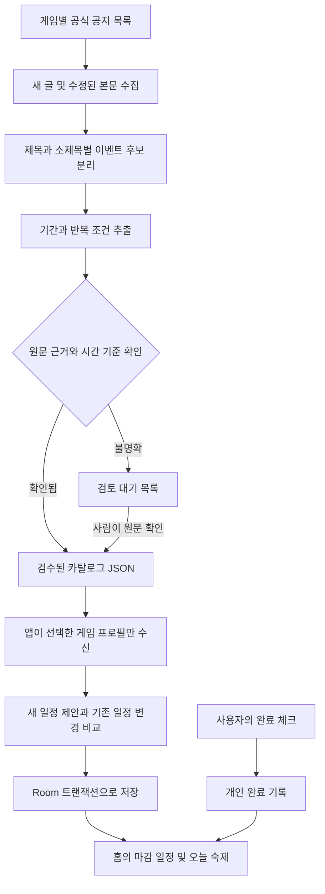

# 공식 공지 수집과 이벤트 자동 등록 상세 설계

김태준 · 2026626007 · 설계일 2026-10-23

일정은 자동으로 가져오고 완료는 사용자가 직접 체크한다. 게임별 수집기를 휴대폰 안에 각각 넣지 않고, 공지를 일정 카탈로그로 정리하는 부분과 Android 앱에서 가져와 저장하는 부분을 분리한다. 이 문서는 구현 설계이며 실제 수집 작업·배포 서비스·Android 앱은 아직 운영하지 않는다.

## 확정한 이용 환경

| 앱 내부 프로필 키 | 게임 | 배급사·서버 | 공지 언어 |
| --- | --- | --- | --- |
| `ww-kuro-asia` | 명조 | KURO / Asia | ko-KR |
| `gf2-haoplay-kr` | 소녀전선 2 | HAOPLAY / 한국판 | ko-KR |
| `endfield-gryphline-asia` | 명일방주 엔드필드 | GRYPHLINE / Asia | ko-KR |

사용자가 위 조합을 확인했다. 게임명만 비교하지 않고 프로필 키를 정확히 대조한다. 소녀전선 2의 SUNBORN 글로벌판·중국판, 엔드필드 Americas/Europe의 날짜는 이 프로필에 가져오지 않는다. 공지 언어가 한국어라는 이유만으로 모든 원문 시각을 한국 시간으로 가정하지 않는다.

## 전체 처리 흐름

수집부터 날짜 확정까지 모두 무인으로 처리한다고 약속하지 않는다. 앱의 일정 수신은 자동화하되, 판독이 불명확한 공지는 검수 후 배포한다. 카탈로그에는 개인 계정 정보나 개인 완료 기록을 넣지 않는다.

## 게임별 공지 수집 경로

| 게임 | 기준 경로 | 수집 단위 | 주의할 구조 |
| --- | --- | --- | --- |
| 명조 | [한국어 공식 뉴스](https://wutheringwaves.kurogames.com/kr/main/news), [버전 공지 사례](https://wutheringwaves.kurogames.com/kr/main/news/detail/4615) | 공지의 고유 글 번호와 본문 소제목 | 한 버전 공지에 여러 이벤트, 임무와 교환의 서로 다른 마감, 웹 이벤트와 상시 콘텐츠 혼재 |
| 소녀전선 2 | [HAOPLAY 한국판 공식 사이트](https://gf2.haoplay.com/kr/)와 [한국 공식 카페](https://cafe.naver.com/exilium) | 운영진 공지 글 번호와 본문의 일정 구간 | 일반 이용자 게시물 제외, 공개 본문 접근 가능 여부 확인, 글로벌판 날짜 혼입 방지 |
| 엔드필드 | [한국어 공식 사이트](https://endfield.gryphline.com/ko-kr), [버전 업데이트 공지 사례](https://endfield.gryphline.com/ko-kr/news/9560) | 공지 글 번호와 번호가 붙은 이벤트 소제목 | 서버별 시각, 콘텐츠 추가 개방, 점검 전 종료, 교환 장소 운영 기간의 분리 |

### 명조 수집기

1. 공식 뉴스의 공지·이벤트·버전 업데이트 목록에서 글 링크를 수집한다.
2. 허용한 도메인과 한국어 경로의 글 번호로 중복을 제거한다.
3. 본문에서 신규 이벤트 구간과 각 이벤트 소제목을 분리한다. 공지 전체에 있는 날짜를 한 이벤트에 몰아넣지 않는다.
4. 각 소제목 안에서 참여 기간, 보상 교환 기간, 매일·출석·누적 등의 표현을 추출한다.
5. HTML에 본문이 없으면 공식 페이지의 공개 렌더링 결과를 읽는 어댑터를 검토한다. 본문이 이미지인 부분은 OCR 후보로 분리하고 원문 대조 전에는 확정하지 않는다.

웹페이지가 내부적으로 쓰는 주소를 공개 개발자 API라고 간주하지 않는다. 실제 어댑터의 선택자와 접근 허용 범위는 구현 시 현재 페이지로 확인한다.

### 소녀전선 2 수집기

한국판은 공식 카페 공지의 본문 확보가 먼저 검증되어야 한다. 이번 조사에서는 카페 본문을 직접 검증하지 못했으므로 완전 자동 수집이 이미 가능한 것으로 적지 않는다.

- 새 글 발견 보조로 [네이버 카페글 검색 API](https://developers.naver.com/docs/serviceapi/search/cafearticle/cafearticle.md)를 사용할 수 있다. 공식 API는 공개 게시판 검색 결과를 반환하며, 제목·링크·요약·카페 정보를 제공한다.
- 요청 예시는 `GET https://openapi.naver.com/v1/search/cafearticle.json?query=소녀전선2&sort=date`이다. 실제 구현에서는 인코딩, 페이지 범위와 호출량을 제한한다. 발급받은 Client ID·Secret은 수집 측에서 관리하며 APK나 공개 JSON에 넣지 않는다.
- 검색 결과의 카페 주소를 고정한 공식 카페와 비교한다. 검색 결과만으로 운영진 공지인지 확정할 수 없으므로, 공지 게시판·작성 주체와 원문을 추가 확인한다. 확인한 공지 URL 목록을 별도로 유지한다.
- 공개 본문을 허용된 방법으로 읽을 수 있으면 추출기로 보낸다. 로그인·접근 제한 또는 이미지 판독 문제로 확보하지 못하면 담당자가 원문 링크와 확인한 기간을 검수 데이터로 등록한다. 요약문만으로 마감을 추정하지 않는다.
- 검색 색인은 신규·수정 글 전체를 즉시 보장하지 않는다. 공식 공지 게시판과 이미 등록한 진행 중 공지를 재확인하는 경로를 함께 둔다.

이 경우에도 앱 사용자가 이벤트를 매번 입력할 필요는 없다. 작성자가 검수한 공통 카탈로그를 앱이 자동으로 받는다. 다만 소전2 수집 경로가 검증될 때까지 운영자 검수가 남는다는 점을 구분한다.

### 엔드필드 수집기

1. 한국어 공식 공지에서 버전 업데이트와 별도 이벤트·점검 안내를 수집한다.
2. 신규 이벤트의 소제목을 경계로 기간·설명·추가 개방 시각을 묶는다.
3. Asia 구간만 선택하고, 해당 공지에 명시된 UTC 기준으로 변환한다. 예시 공지는 Asia를 UTC+8로 안내한다.
4. “버전 업데이트 점검 전”은 다음 점검의 **시작 시각**이 별도 공지로 확정된 뒤 연결한다. 점검 종료 예정 시각으로 바꾸지 않는다.
5. “업데이트 후”의 시작은 실제 개방 근거가 확인될 때 확정한다. 다음 점검 미공지는 종료 미확정으로 남기고 임의의 버전 길이로 계산하지 않는다.

공식 SKPORT의 개인 진행 데이터는 이 수집 경로에 사용하지 않는다. 공통 일정과 사용자의 개인 완료 기록을 분리한다.

## 수집 결과를 확정하는 규칙

| 단계 | 저장할 정보 | 반영 조건 |
| --- | --- | --- |
| 발견 | 원문 URL, 글 ID, 게임 프로필, 게시일 | 허용한 공식 출처·언어·서버 일치 |
| 변경 감지 | 본문 내용 해시, 마지막 확인 시각 | 제목·본문의 의미 있는 구간만 비교 |
| 추출 | 이벤트 후보명, 원문 기간 표현, 시간 기준, 반복 표현 | 어떤 문장에서 추출했는지 근거 구간 연결 |
| 검증 | 시작·종료 선후 관계, 서버·시간대, 단계 연결 | 서로 모순되지 않고 근거 확인 가능 |
| 배포 | 안정된 키, 개정 번호, 확정 시각, 검수 상태 | 신규 유형·OCR·모호한 표현은 검수 후 배포 |

정형화된 이미 검증한 패턴은 검증을 통과하면 배포 대상으로 만들 수 있다. LLM은 이벤트 후보와 근거 구간 정리에 보조적으로 사용할 수 있으나 근거 없는 시간·숙제 횟수를 만들게 하지 않는다. 전체 공지·이미지를 공개 저장소에 복제하기보다 원문 링크와 필요한 구조화 사실을 남긴다.

목록에서는 마지막으로 확인한 글까지의 새 글을 요청 수 제한 안에서 찾는다. 새 글이 없어도 현재 카탈로그에 연결된 진행·예정 이벤트 원문을 다시 확인해 수정 공지를 잡는다. 목록 탐색 한도를 넘거나 원문을 확인하지 못한 경우 수집 완료로 표시하지 않고 재확인 대상으로 남긴다.

## 이벤트를 세부 일정과 숙제로 나누는 기준

| 원문 내용 | 앱 등록 방식 | 완료 체크 |
| --- | --- | --- |
| 이벤트 기간 동안 도전 가능 | PLAY 또는 CHALLENGE 세부 일정 | 목표 달성, 보상 수령을 각각 확인 |
| 후반 스테이지가 나중에 개방 | 별도 STAGE 일정, 개방 시각을 시작으로 사용 | 후반 목표와 보상 확인 |
| 교환 상점이 더 오래 운영 | SHOP 일정, 참여 일정과 같은 묶음 | 원하는 교환 완료 |
| 매일 지정 목표·보상 | 해당 일정에 연결한 반복 숙제 1개 이상 | 현재 서버 회차에 직접 체크 |
| 누적 7일 출석 | 일일 출석 확인 + 누적 최종 보상 체크 | 누적 수령 완료는 별도 확인 |
| 일회성 미션·상자 수령 | 일정 안의 일회성 체크 항목 | 한 번 완료하면 다음 날 유지 |
| 특정 콘텐츠 추가 개방일만 안내 | 상세의 개방 안내 또는 STAGE 일정 | 개방 알림 자체를 숙제 완료로 취급하지 않음 |
| 상시 콘텐츠·픽업·상품 홍보 | 기본 숙제 목록에서 제외 | 원하면 사용자가 관심 일정으로 선택 |

반복 횟수나 세부 게임 내 임무가 공지에 없으면 “오늘 이벤트 목표와 보상 확인” 정도의 프리셋만 제안한다. 구체적인 전투 횟수·점수·임무를 지어내지 않는다. 일일 반복을 우선 구현하고 주간 반복은 후속 범위로 둔다.

## 공식 공지에서 적용한 분해 예

- **명조:** 3.3 버전 공지의 「해조의 답례」는 임무와 교환의 종료가 다르다. 임무 종료 일정과 상점 마감 일정을 같은 묶음의 두 행으로 만든다. 같은 공지의 매일 목표 이벤트는 별도 반복 숙제로 분류한다. 이 공지는 과거 사례이며 현재 일정 목록으로 배포하지 않는다.
- **엔드필드:** 「단청도」 공지의 「위기 대응 준비」는 Asia 기준 2026/10/29 04:00~11/05 04:00의 참여 일정과 일일 확인 숙제로 나눈다. UTC+8 기준이라 한국 표시 시각은 각각 05:00이다. 「위기 협약 · 잿빛 실험 작전」은 참여 종료가 점검 전으로 미확정이고 상점은 12/03 04:00까지여서, 두 종료 시각을 하나로 합치지 않는다.
- **소전2 한국판:** 공식 공지를 확보하면 참여·도전·상점·일일 임무를 같은 규칙으로 나눈다. 한국판 본문 확인 전에는 글로벌 운영사의 비슷한 이벤트 날짜를 채워 넣지 않는다. 정확한 임무명과 기간은 원문 검수 뒤 생성한다.

## 카탈로그 식별자와 JSON 계약

`profileKey + groupKey + phaseKey`를 기준으로 한 세부 일정의 `sourceKey`를 만든다. 최초 키는 등록 과정에서 확정하고 제목·종료일·공지의 목록 순서가 바뀌어도 유지한다. 이벤트가 다른 공지에서 재안내되어도 기존 키에 출처를 추가한다. 같은 이름의 다음 시즌 이벤트는 새 묶음으로 만든다.

| 필드 | 뜻 |
| --- | --- |
| `schemaVersion` | 앱이 해석할 수 있는 구조 버전 |
| `catalogRevision`, `generatedAt` | 배포 개정 번호와 생성 시각 |
| `exampleOnly` | 예제 데이터 여부. 실제 앱은 true인 피드를 거부 |
| `profile` | 게임·배급사·서버·언어의 확정 조합 |
| 세부 일정의 `sourceCheckedAt`, `sourceUrl` | 그 일정의 원문을 마지막으로 확인한 시각과 출처. 공지마다 따로 관리 |
| `groupKey` | 한 이벤트의 여러 마감을 묶는 고정 키 |
| `sourceKey`, `phaseKind`, `revision` | 세부 일정의 고정 키, 종류, 개정 번호 |
| `startAt`, `endAt`, `timeState` | UTC 시각과 확정·확인 필요 상태 |
| `sourceEvidence` | 원문의 기간 표현, 시간 기준, 소제목 등 추출 근거 위치 |
| `checkTemplates` | 일회성 확인 항목과 고정 `sourceItemKey` |
| `dailyTaskTemplates` | 반복 숙제와 고정 `sourceTaskKey`, 회차 기준 |

초기 JSON 예시는 [예제 카탈로그](examples/catalog.example.json)에 있다. 해당 예제의 이름·날짜는 가상 데이터다. 이후 구현한 엔필 실제 피드는 [검수 결과와 배포 계약](endfield-release.md)에 별도로 정리했다. 실제 공지의 콘텐츠 업데이트는 `STAGE` 기간 대신 `CONTENT_UPDATE / INSTANT`로 처리한다.

## 앱에서 자동 수신하고 등록하는 흐름

1. 게임 등록 시 확정한 프로필을 저장하고 해당 프로필의 카탈로그만 선택한다.
2. 첫 진입·수동 새로고침·배경 갱신에서 매니페스트 개정을 확인한다. 앱 복귀 시 마지막 수신이 1시간 이상 지났으면 확인한다. 변경이 없으면 그대로 사용한다.
3. 게임 등록 시 참여·도전·상점·출석 등 관리할 유형과 “새 일정 자동등록”을 한 번 선택한다. 켜 두면 검수된 새 묶음의 세부 일정·체크 항목·반복 숙제를 한 트랜잭션으로 등록하고 “새 이벤트 N개”를 알린다. 꺼 두면 제안함에서 여러 묶음을 한 번에 선택해 등록한다. 픽업·상품 안내와 확인 대기 자료는 이 자동등록 대상에서 제외한다.
4. 선택한 묶음의 검수된 기간 변경은 자동 반영하고 변경 내용을 표시한다. 직접 수정한 일정은 변경 대기로 둔다.
5. 사용자는 홈에서 기간이 가까운 남은 이벤트와 오늘 숙제를 확인하고 직접 체크한다. 일정 수신은 인게임 보상 지급이나 진행 변경을 수행하지 않는다.

기존 이벤트에 새로운 체크 항목·반복 숙제가 생기면 “추가된 항목”으로 먼저 제안한다. 필수 항목을 갑자기 추가해 완료된 이벤트를 조용히 미완료로 돌리지 않는다. 숨기거나 등록을 거절한 묶음은 기기 설정에 제외 키를 보존해 동기화할 때마다 다시 만들지 않는다. 사용자가 숨김 해제를 선택할 수 있게 한다.

배포 매니페스트에는 프로필별 개정 번호·개정 전용 JSON 경로·내용 해시를 둔다. 앱은 본문 해시와 구조를 검증한 뒤 적용한다. 캐시 지연으로 새 본문을 아직 받지 못하면 이전 정상 자료를 유지한다. 원문 URL의 서버 확인 시각과 JSON을 내려받은 시각도 따로 표시한다.

## Room 저장 보완

기존 기본 6개 테이블과 `event_sources` 구조를 활용한다. 중간고사 요약 DB에 다음 식별·갱신 정보를 추가하는 상세 설계다. 아직 Entity 코드나 마이그레이션을 구현한 상태는 아니다.

| 대상 | 보완 컬럼 또는 규칙 |
| --- | --- |
| `games` | `profileKey TEXT` 추가. 확정한 게임·배급사·서버 조합을 저장 |
| `events` | `sourceRevision INTEGER`, `phaseKind TEXT`, `sourcePayloadJson TEXT` 추가. 원본 기간·기본 항목과 표시용 메타데이터 보존 |
| `event_check_items` | `sourceItemKey TEXT NULL` 추가, `(eventId, sourceItemKey)` UNIQUE. 수동 항목의 키는 NULL |
| `daily_tasks` | `sourceTaskKey TEXT NULL` 추가, `(eventId, sourceTaskKey)` UNIQUE. 자동 생성 숙제는 부모 이벤트를 반드시 연결 |
| `event_sources` | `catalogRevision`, `lastAttemptAt`, `sourceCheckedAt`, `etag` 추가. 앱 수신과 원문 확인 시각을 구분 |

`sourceKey`로 기존 이벤트를 먼저 찾고, 있으면 기존 `eventId`를 사용해 메타데이터 컬럼만 UPDATE한다. 자동 증가 PK가 매번 달라지는 삽입이나 부모 행 REPLACE를 쓰지 않는다. Room의 Upsert는 PK 기준이므로 외부 키 조회 없이 그대로 호출하는 것만으로 중복이 해결되지 않는다. [Room DAO 공식 문서](https://developer.android.com/training/data-storage/room/accessing-data)를 근거로 한 저장 계획이다.

체크 상태, 완료 시각, 회차 기록, 메모는 갱신 대상에서 제외한다. 템플릿 키로 기존 항목을 찾고 제목·날짜 변경만으로 항목을 삭제·재생성하지 않는다. 제거된 항목이나 취소 공지는 확인 후 숨기되 과거 기록을 보존한다.

## 홈 표시와 회차 계산

- 이벤트 목록은 종료가 확정되고 일회성 확인 항목 또는 현재 회차의 연결 숙제가 남은 세부 일정을 종료 시각순으로 표시한다. 오늘 숙제 영역에서도 같은 남은 항목을 볼 수 있다. 반복 기간 중 오늘 체크가 끝난 것은 “오늘 완료”이며, 다음 회차에는 다시 확인 대상으로 표시한다.
- 예정·진행·종료는 시간 상태이고 확인 전·일부 확인·확인 완료는 사용자 상태다. 시간이 지났다는 이유로 완료 처리하지 않는다.
- 미확정 시작·종료는 “기간 확인 필요”에서 표시한다. 추정한 시간을 확정 카운트다운에 넣지 않는다.
- 오늘 숙제는 게임의 서버 시간대와 초기화 시각으로 회차를 계산하고, 이벤트 구간과 겹치는 회차만 제공한다. 유효 구간은 `max(회차 시작, 이벤트 시작)`부터 `min(다음 회차 시작, 이벤트 종료)`까지다.
- 일일 기록의 `(taskId, cycleStartAt)`를 유지한다. 이벤트 기간 연장이나 제목 수정으로 이전 완료 기록을 지우지 않는다.
- 실제 인게임 초기화 시각을 별도로 확인해 설정한다. 한국 표시 시간이나 이벤트 시작 시간을 초기화 시각으로 복사하지 않는다.

## 변경과 장애 처리

| 상황 | 앱과 배포 측 처리 |
| --- | --- |
| 같은 개정을 재수신 | 중복 행 없이 종료, 개인 기록 유지 |
| 기간 연장·단축 | 같은 키로 반영, 변경 표시, 확인 기록 유지 |
| 시각 미확정→확정 | 원문 검수 후 카운트다운 대상으로 이동 |
| 직접 수정한 일정 | 변경안을 보관하고 적용·기존 값 유지 선택 |
| 같은 원문이 수정됨 | 본문 해시 비교 후 영향 있는 일정만 개정 |
| 수집 결과에서 글이 사라짐 | 자동 삭제 금지, 원문 재확인 |
| 로그인·403·429·판독 실패 | 마지막 정상 카탈로그 유지, 재시도 간격 증가, 최신 성공으로 표시하지 않음 |
| 한 게임의 파싱 실패 | 그 게임의 이전 자료 유지. 다른 게임의 정상 개정은 독립 배포 가능 |
| JSON 손상·지원하지 않는 버전 | 해당 프로필 묶음을 저장하지 않고 기존 DB 유지 |
| 다른 서버 자료·예제 피드 | 운영 앱에서 등록 거부 |

수집을 시도한 시각, 원문 확인에 성공한 시각, JSON 배포 시각, 앱이 가져온 시각을 구분한다. 앱이 오늘 JSON을 받았더라도 원문 확인이 오래됐다면 “원문 확인 오래됨”을 표시한다.

## 혼자 개발할 수 있는 운영 구성

수집 측은 Python과 게임별 어댑터, 검수 데이터, JSON 생성기로 구성한다. 정적 JSON 배포는 공개 저장소 또는 별도 정적 호스팅을 후보로 둔다. 실행 예약을 나중에 GitHub Actions로 구현한다면 약 2시간 간격을 목표로 하고 정각을 피한다. 이 문서 작성으로 실제 예약 워크플로를 생성하거나 켜지는 않는다.

Android는 약 6시간 간격의 WorkManager, 앱 복귀 시 오래된 자료 확인, 사용자의 새로고침으로 갱신한다. 앱 수신과 Actions 예약은 지연될 수 있어 실시간 갱신으로 표현하지 않는다. [GitHub 예약 실행 제약](https://docs.github.com/en/actions/reference/workflows-and-actions/events-that-trigger-workflows#schedule), [Android 배경 작업 제약](https://developer.android.com/develop/background-work/background-tasks/persistent/getting-started/define-work)을 반영했다.

개발 순서는 **앱의 JSON 수신·병합 → 엔드필드 텍스트 공지 수집기 → 명조 어댑터 → 소전2 공개 본문 경로 검증**이다. 세 게임 카탈로그 자동 수신은 목표 기능으로 삼고, 수집기가 불확실한 원문은 검수 입력으로 보완한다. 사용자 계정 연동과 인게임 완료 자동 판정은 이번 범위에서 제외한다.

## 구현 시 반드시 확인할 사례

같은 JSON 두 번 수신, 공지 제목 변경, 중간 소제목 추가, 다른 공지에서 같은 이벤트 재안내, 종료 연장·단축, 점검 전 미확정, 반복 숙제 초기화 직전·직후, 최종 보상 미수령, PC에서 플레이한 뒤 체크, 서버 불일치, 이미지 공지, 카페 본문 접근 실패를 확인한다. 개발 완료 표시는 실제 수집·저장·복귀 흐름을 실행한 뒤 갱신한다.

[README로 돌아가기](../README.md)
