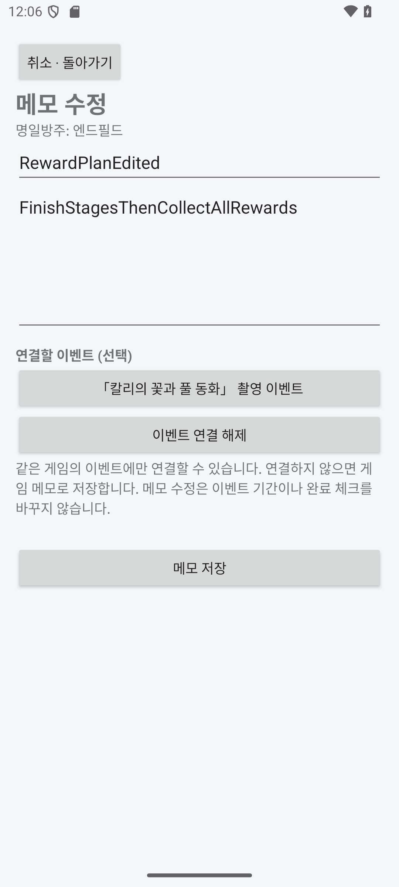
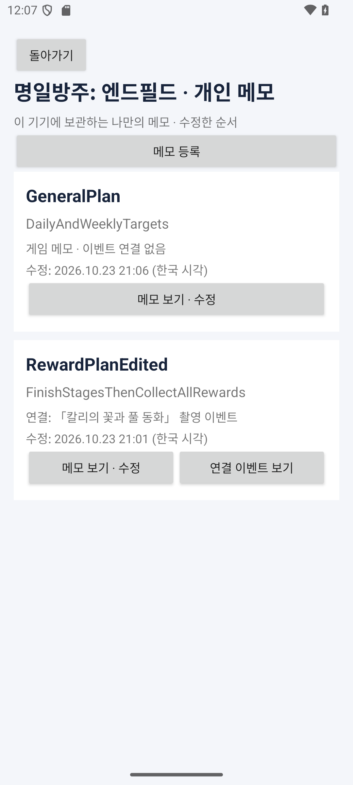

# 개인 메모 게시판과 이벤트 연결

앱 **0.6.0**부터 게임별 개인 메모를 등록·수정한다. 메모는 이 기기의 Room DB에 저장하며 공식 공지나 공개 GitHub JSON에 전송하지 않는다. 다른 사용자와 공유하는 커뮤니티 기능은 없다.

## 사용 방법

1. 홈 → **내 게임 · 이벤트와 숙제 등록** → 원하는 게임의 **개인 메모 게시판**을 연다.
2. **메모 등록**에서 제목과 내용을 입력한다. 제목은 1~100자, 내용은 공백을 제외한 글자가 최소 한 자 있어야 하며 최대 10,000자다. 내용의 줄바꿈과 들여쓰기는 그대로 저장한다.
3. 필요하면 **연결할 이벤트**를 눌러 같은 게임의 일정을 선택한다. 참여와 보상 교환은 별도 항목이므로 어떤 단계에 관한 메모인지 구분할 수 있다. 연결하지 않으면 게임 전체에 대한 메모로 저장한다.
4. 저장하면 게시판으로 돌아온다. 최근 수정한 메모가 위에 나타나며 제목·내용 미리보기·연결 이벤트·수정 시각을 표시한다. 긴 내용은 **메모 보기 · 수정**에서 전체를 확인한다.
5. 기존 메모에서 제목·내용을 수정하고 이벤트 연결을 바꾸거나 **이벤트 연결 해제** 버튼 또는 **이벤트 연결 없음** 선택으로 해제할 수 있다. 취소하면 작성 중 변경을 저장하지 않는다.

| 메모 등록·수정 | 게임별 게시판 |
| --- | --- |
|  |  |

이미지의 영어 제목·내용은 동작 확인용 입력값이다.

홈이나 게임별 이벤트 카드의 **연결 메모 보기 · 작성**으로 들어가면 해당 일정에 연결된 메모만 보여준다. 여기서 등록하면 이벤트를 미리 선택해 준다. **이 게임의 전체 메모 보기**로 필터를 해제할 수 있다. 메모의 **연결 이벤트 보기**는 원래 게임의 해당 참여·교환 카드로 이동한다. 화면 이동은 완료 체크를 바꾸지 않는다.

## 연결과 보존 규칙

- 메모의 게임 소속은 생성할 때 정하고 수정 중 다른 게임으로 옮기지 않는다. 이벤트 선택 목록에는 같은 게임의 일정만 표시하며, 저장 트랜잭션에서도 소속을 다시 검사한다.
- 게임 이름·메모 제목을 ID로 쓰지 않는다. 같은 제목의 메모를 여러 개 만들 수 있고 게임별로 분리한다.
- 메모를 수정할 때 같은 UUID와 최초 작성 시각을 유지하고 최근 수정 시각만 갱신한다. 기기 시각이 뒤로 바뀌어도 저장된 수정 시각을 과거로 되돌리지 않는다.
- 이벤트 연결·해제는 메모 행만 바꾼다. 이벤트 기간·이벤트 내부 설명·참여 체크·일일 완료·알림 설정과 발송 기록에는 쓰지 않는다.
- 공식 이벤트와 직접 등록한 이벤트 모두 연결 가능하다. 기간 확인 필요·종료·보관 상태에서도 공략이나 기록을 남길 수 있다. 공지에서 빠지거나 교환 일정을 숨겨도 이벤트 행을 보관하므로 연결을 유지하고 **보관 일정**으로 표시한다.
- 공식 제목이 바뀌면 게시판의 연결 이름은 최신 제목을 보여주고, 사용자가 작성한 메모 내용은 유지한다. 원문 설명과 개인 메모는 별도 데이터다.
- 앱 재실행·공식 새로고침·버전 업데이트 후 메모를 유지한다. 앱 데이터 삭제·제거에 대비한 백업·내보내기와 여러 기기 동기화는 이번 기능에 포함하지 않는다. 메모 삭제·검색 기능도 후속 범위다.

입력 초안은 `SavedStateHandle`로 화면 재생성 시 복원한다. 저장 오류 시 초안을 유지하고 이유를 표시한다. 저장하지 않은 초안까지 앱 강제 종료 후 영구 보관하는 자동 저장 기능은 제공하지 않는다.

## Room v6

스키마 6은 기존 11개 테이블에 `memos` 한 개를 추가한다. 기존 체크·회차·알림 설정과 발송 이력은 변경하지 않는다. 1→2→3→4→5→6 업그레이드 경로를 등록하며 앱을 제거하지 않고 업데이트한다.

| 컬럼 | 자료형·키 | 용도 |
| --- | --- | --- |
| `memoId` | TEXT PK | `memo:<UUID>`, 수정 후 유지 |
| `profileKey` | TEXT NOT NULL, games FK·인덱스 | 메모 소속 게임 |
| `eventKey` | TEXT NULL, events FK·인덱스 | 선택적 세부 일정 연결 |
| `title` | TEXT NOT NULL | 메모 제목 |
| `body` | TEXT NOT NULL | 개인 메모 본문 |
| `createdAt` | INTEGER NOT NULL | 최초 작성 UTC 밀리초 |
| `updatedAt` | INTEGER NOT NULL | 마지막 수정 UTC 밀리초 |

게임과 이벤트 FK의 삭제 정책은 `RESTRICT`다. 연결한 이벤트의 물리 삭제로 메모가 조용히 사라지지 않는다. 같은 게임인지 여부는 `MemoRepository.save`가 트랜잭션 안에서 검증한다. 공식 수신기는 `memos` 테이블에 쓰지 않는다.

```text
게임의 개인 게시판 / 이벤트의 연결 메모 → MemoBoardFragment
  → MemoEditorFragment → MemoEditorViewModel → MemoRepository
  → 입력·소속 검증 → Room 트랜잭션 → memos Upsert
  → Flow → 최근 수정순 목록
조회: memos LEFT JOIN events → 최신 연결 이름·보관/확인 필요 상태 표시
```

현재 0.7은 실행 앱 연결 컬럼을 추가한 [Room 스키마 7](game-shortcuts.md)을 사용한다. 아래 메모 기능 검증에 더해 기존 업그레이드 경로도 v7까지 실행한다.

## 검증

Android 테스트 **78개**가 통과했다. 기존 66개와 메모 테스트 12개다. APK 빌드와 Lint 오류 0건을 확인했다.

- 연결 없는 게임 메모, 같은 제목·여러 게임의 분리, 본문 줄바꿈·들여쓰기 보존
- 제목·내용 수정과 이벤트 연결/해제 후 ID·작성 시각·기존 완료 체크 유지
- 다른 게임의 이벤트·메모, 없는 게임·이벤트·메모, 빈 값·길이 초과 거부
- 이벤트 이름·기간·보관 상태 변경 후 메모 연결과 본문 유지
- 공식 일정 제거·재등장, 파일 DB 재실행, FK 삭제 제한과 수정순 정렬
- 실제 v5 스키마의 v6 업그레이드 후 체크·설정·알림 발송 이력 보존, 기존 v1~v4 업그레이드 경로

실제 UI 검증은 API 35 에뮬레이터에서 수행했다. 기존 앱 업데이트, 이벤트 연결 메모와 게임 메모 작성·수정, 화면 회전, 연결 이벤트 이동, 연결 선택/해제, 취소, 공식 새로고침·프로세스 재실행 후 보존과 게임별 분리를 확인했다. 실제 휴대폰 검증은 남아 있다.

관련 코드: [메모 저장·검증](../android/app/src/main/java/kr/ac/jeiu/gamescheduler/data/MemoRepository.kt), [게시판](../android/app/src/main/java/kr/ac/jeiu/gamescheduler/MemoBoardFragment.kt), [입력 상태](../android/app/src/main/java/kr/ac/jeiu/gamescheduler/MemoEditorViewModel.kt), [Room v6](../android/app/schemas/kr.ac.jeiu.gamescheduler.data.SchedulerDatabase/6.json), [메모 테스트](../android/app/src/test/java/kr/ac/jeiu/gamescheduler/MemoTest.kt).

[README](../README.md) · [Android Studio 실행](android-implementation.md) · [이벤트 직접 등록·수정](manual-events.md)
