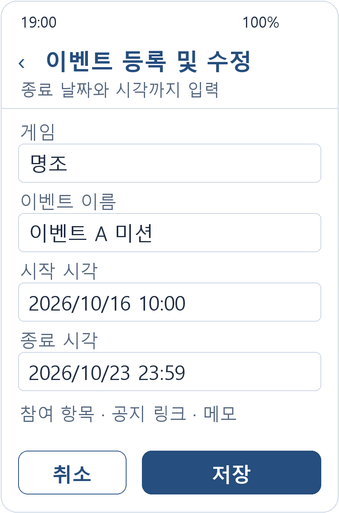
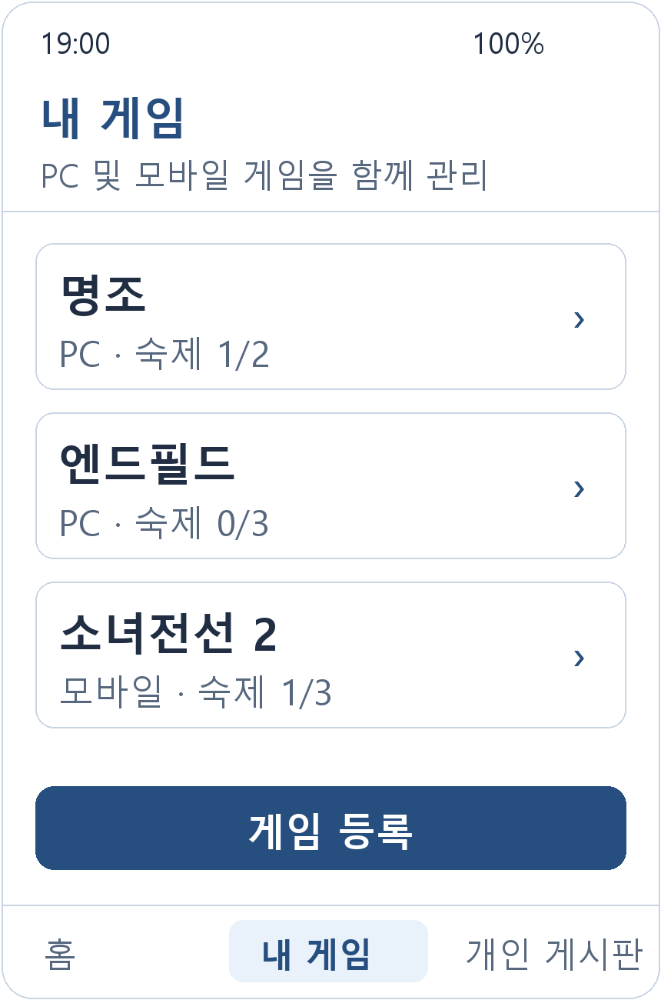
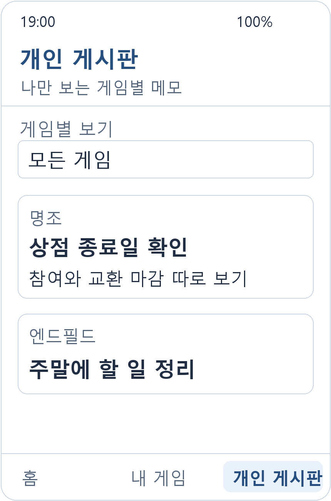
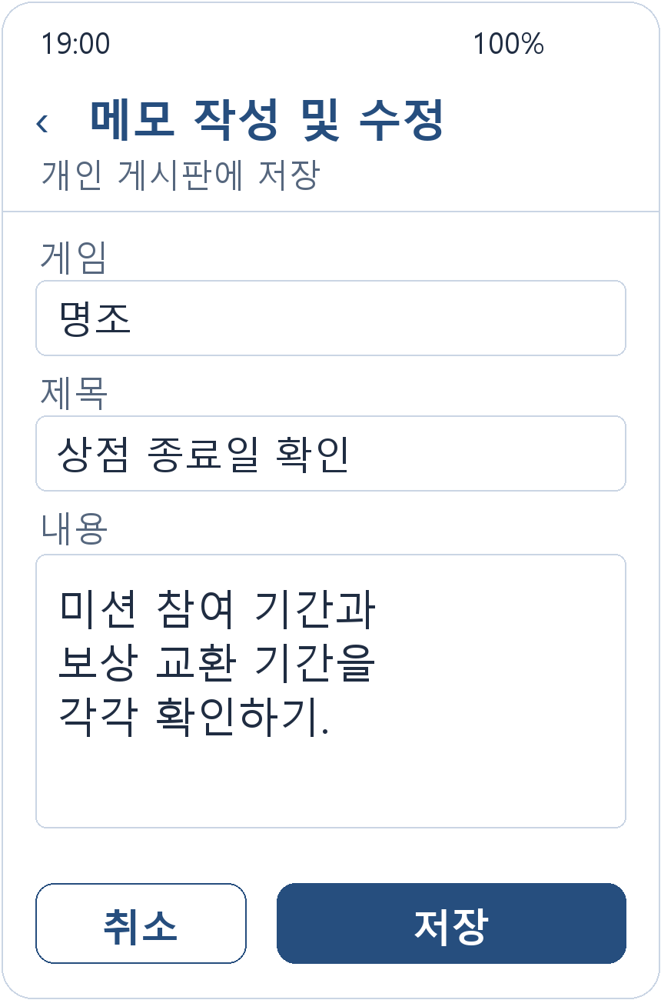

# 화면 구성과 화면 이동 설계

게임 숙제 스케줄러

화면 시안은 구현 전 설계이며 이벤트명·날짜·체크 상태는 설명용 예시이다. 목록을 표현하는 홈, 내 게임, 게임 상세, 개인 게시판에 RecyclerView를 사용할 예정이다.

## 화면 목록

| 번호 | 화면 | Fragment | 주요 역할 |
| --- | --- | --- | --- |
| 1 | 홈 | `HomeFragment` | 종료 임박 미완료 이벤트를 먼저 표시한다. 상태 탭, 남은 시간, 일일 숙제 요약을 제공한다. |
| 2 | 이벤트 상세 | `EventDetailFragment` | 정확한 시작·종료 시각과 공지 링크를 확인하고 미션 달성·보상 수령을 체크한다. |
| 3 | 이벤트 등록 및 수정 | `EventEditFragment` | 게임, 제목, 기간, 세부 체크 항목과 출처를 입력한다. 저장하면 진입 화면으로 복귀한다. |
| 4 | 내 게임 | `GameListFragment` | 등록한 게임별 숙제와 이벤트 현황을 표시한다. 게임 등록은 보조 입력창에서 처리한다. |
| 5 | 게임 상세 | `GameDetailFragment` | 선택한 게임의 일일 숙제, 초기화 시각, 이벤트와 메모를 확인한다. |
| 6 | 개인 게시판 | `MemoListFragment` | 게임별 메모를 모아 보고 필터링한다. 다른 사용자와 공유하는 커뮤니티 기능은 포함하지 않는다. |
| 7 | 메모 작성 및 수정 | `MemoEditFragment` | 게임, 선택 이벤트, 제목과 내용을 입력하고 저장하거나 취소한다. |

## 홈 표시 기준

- 시작 시각이 지났고 아직 종료되지 않은 미완료 이벤트를 종료 시각 오름차순으로 표시한다.
- 종료까지 24시간 이내인 일정은 문구와 색으로 함께 강조한다. 정확한 종료 시각과 남은 시간을 함께 표시한다.
- 예정, 종료·완료 상태도 별도 목록에서 다시 확인할 수 있다.
- 기간이 불명확한 일정은 `기간 확인 필요`로 표시한다. 종료 시각을 임의로 계산하지 않는다.
- 게임 실행이나 일일 숙제 완료만으로 이벤트를 완료 처리하지 않는다. 필수 체크 항목을 모두 완료해야 이벤트 완료로 판단한다.
- 앱 복귀와 시간 경과 시 현재 시각을 다시 적용해 종료 상태와 남은 시간을 갱신한다.

## 주요 화면 이동

| 시작 화면 | 사용자 동작 | 도착 화면 또는 결과 |
| --- | --- | --- |
| 홈 | 이벤트 카드 선택 | 이벤트 상세 |
| 홈 또는 게임 상세 | 이벤트 등록 | 이벤트 등록·수정 |
| 이벤트 상세 | 수정 선택 | 이벤트 등록·수정 |
| 내 게임 | 게임 선택 | 게임 상세 |
| 게임 상세 | 이벤트 선택 | 이벤트 상세 |
| 개인 게시판 또는 게임 상세 | 메모 선택·작성 | 메모 작성·수정 |
| 이벤트·메모 입력 | 저장 | 진입 화면으로 복귀하고 목록 갱신 |
| 이벤트·메모 입력 | 취소·뒤로가기 | 저장 없이 진입 화면으로 복귀 |

게임 등록과 일일 숙제 항목 편집은 보조 입력창으로 구성한다. 필수 입력과 기간의 선후 관계를 검사한 뒤 저장한다. 게임 실행 버튼은 휴대폰에 설치된 모바일 게임으로 연결하며, 미설치 시 안내한다. PC 게임은 노트북에서 플레이한 뒤 앱에서 체크한다.

## 화면별 시안

### 1 홈

`HomeFragment`

종료 임박 미완료 이벤트를 먼저 표시한다. 상태 탭, 남은 시간, 일일 숙제 요약을 제공한다.

### 2 이벤트 상세

`EventDetailFragment`

정확한 시작·종료 시각과 공지 링크를 확인하고 미션 달성·보상 수령을 체크한다.

### 3 이벤트 등록 및 수정

`EventEditFragment`

게임, 제목, 기간, 세부 체크 항목과 출처를 입력한다. 저장하면 진입 화면으로 복귀한다.

### 4 내 게임

`GameListFragment`

등록한 게임별 숙제와 이벤트 현황을 표시한다. 게임 등록은 보조 입력창에서 처리한다.

### 5 게임 상세

`GameDetailFragment`

선택한 게임의 일일 숙제, 초기화 시각, 이벤트와 메모를 확인한다.

### 6 개인 게시판

`MemoListFragment`

게임별 메모를 모아 보고 필터링한다. 다른 사용자와 공유하는 커뮤니티 기능은 포함하지 않는다.

### 7 메모 작성 및 수정

`MemoEditFragment`

게임, 선택 이벤트, 제목과 내용을 입력하고 저장하거나 취소한다.

[README로 돌아가기](../README.md)
